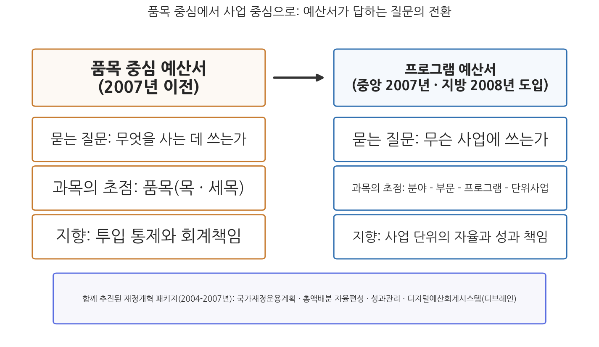
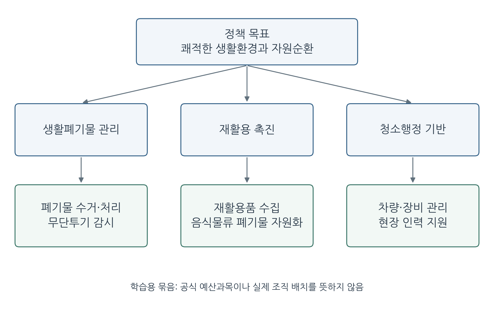
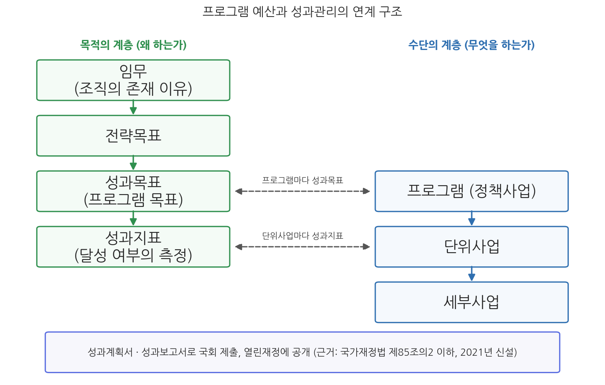
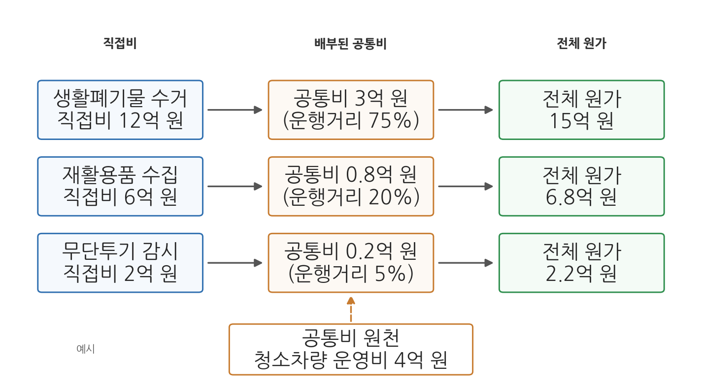
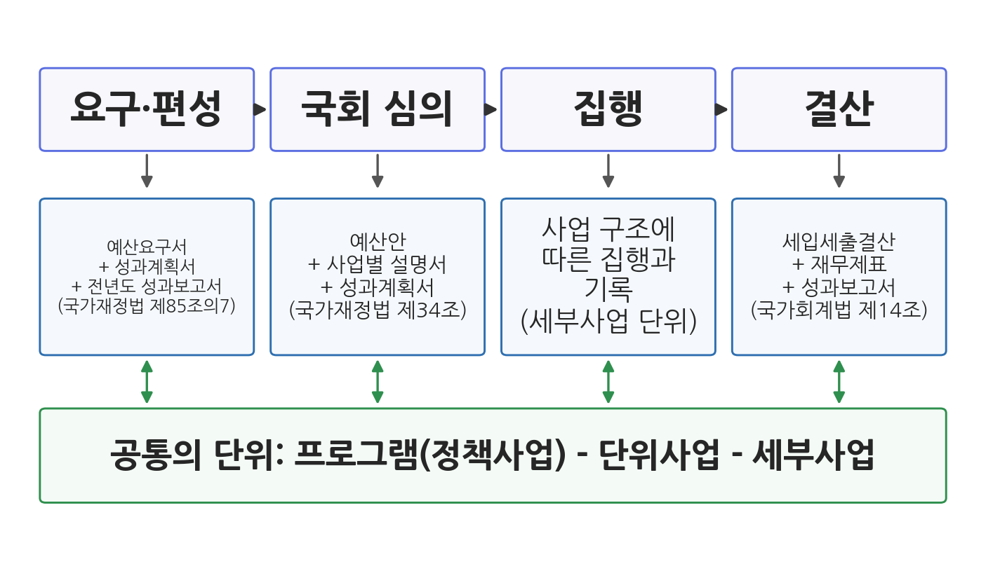

# 5주차 2차시. 프로그램 예산제도

> 모든 예산체계는, 그것이 아무리 초보적인 것일지라도 계획과 관리와 통제의 과정을 함께 담고 있다.
> (앨런 쉬크, 「PPB로 가는 길: 예산개혁의 단계」, 1966)

## 이 장에서 배우는 것

1차시에서 우리는 세출예산 과목체계의 허리에 프로그램과 단위사업이 있다는 것을 보았다. 그런데 이 허리는 처음부터 있던 것이 아니다. 2007년도 예산 이전의 한국 예산서는 품목 중심의 문서였다. 예산서를 펼치면 어느 부처가 인건비로 얼마, 물건비로 얼마, 보조금으로 얼마를 쓰는지는 보였지만, 정작 그 돈으로 무슨 사업을 해서 무엇을 이루려는지는 과목체계의 전면에 드러나지 않았다. 노인복지에 얼마가 가는지 알려면 여러 과목에 흩어진 숫자를 손으로 모아야 했다. 2007년, 예산서의 문법이 바뀌었다. 정부의 일을 사업(프로그램)의 묶음으로 재편하고 예산을 그 사업 구조 위에 얹은 프로그램 예산제도가 중앙정부에 도입된 것이다. 지방자치단체도 2008년부터 사업예산제도라는 이름으로 같은 길을 따랐다.

이 전환은 단순한 서식 개정이 아니라, 예산이라는 문서가 답하는 질문을 "무엇을 사는가"에서 "무슨 일을 하는가"로 바꾼 사건이다. 쉬크의 언어로 말하면 통제 지향의 예산서를 관리와 계획 지향의 예산서로 재설계한 것이고, 그 위에서 비로소 사업 단위의 성과를 묻는 일이 가능해졌다. 이번 차시는 이 제도의 논리와 구조, 그리고 실제 예산서 속의 모습을 배우는 시간이다. 구체적으로 다음을 배운다.

- 프로그램(정책사업)의 개념과 프로그램 예산제도의 의의
- 2007년 도입의 배경: 품목 중심 예산의 한계와 2000년대 중반의 재정개혁 패키지
- 프로그램 예산의 구조: 기능 분류, 프로그램 구조, 품목 분류의 연계와 조직과의 정합
- 실제 지방자치단체 사업예산서에 나타난 정책사업-단위사업-세부사업 구조
- 프로그램 구조와 성과지표가 연계되는 방식, 그리고 그 연계의 한계
- 사업 단위의 원가 정보를 만드는 방법과 공통비 배부의 원리
- 예산안, 성과계획서, 결산보고서가 같은 사업 구조 위에서 이어지는 중앙정부 문서체계

<strong>이 장의 로드맵</strong> 
이 장은 하나의 질문을 따라 전개된다. <em>"예산을 품목이 아니라 사업으로 묶으면 무엇이 달라지는가?"</em>  
<strong>2.1</strong> 프로그램 예산제도의 개념과 의의를 정리한다 →
<strong>2.2</strong> 2007년 도입의 배경과 제도의 구조를 본다 →
<strong>2.3</strong> 실제 예산서 속의 사업예산구조를 읽는다 →
<strong>2.4</strong> 프로그램 구조가 성과지표와 연계되는 방식과 그 한계를 확인한다 →
<strong>2.5</strong> 사업 단위의 원가와 공통비 배부를 계산해 본다 →
<strong>2.6</strong> 예산서와 성과계획서와 결산보고서를 잇는 문서체계를 확인하고, 다음 주(예산의 종류)를 예고한다.

## 2.1 프로그램 예산제도의 의의

### 사업을 예산의 기본 단위로

프로그램 예산제도는 프로그램(정책사업)을 중심으로 예산을 편성하고 운용하는 제도다. 여기서 프로그램이란 동일한 정책목표를 수행하는 단위사업(project)들의 묶음을 말한다. 예산의 기본 구조는 기능-프로그램(정책사업)-단위사업-세부사업으로 짜이며, 예산의 편성, 심의, 집행, 결산, 성과평가가 모두 이 사업 구조를 공통의 단위로 삼는다. 1차시에서 본 과목체계의 언어로 말하면, 기능별 분류(분야·부문)와 품목별 분류(목·세목) 사이에 사업별 분류라는 허리를 세우고 그 허리를 예산 운용의 중심으로 삼는 제도다.

<strong>정의 · 프로그램과 프로그램 예산제도</strong> 
<strong>프로그램</strong>(program, 정책사업)은 동일한 정책목표를 달성하기 위한 단위사업들의 묶음이다. <strong>프로그램 예산제도</strong>는 이 프로그램을 예산 편성·운용의 기본 단위로 삼는 제도로, 한국의 중앙정부는 2007년, 지방자치단체는 2008년부터 공식 도입했다(양자를 구분하기 위해 지방정부의 제도는 <strong>사업예산제도</strong>라고 불린다). 프로그램 중심의 구조는 사업 단위의 성과 지향적 예산 편성과 운용을 가능하게 한다.

### 품목 중심 예산의 한계에서 출발한다

프로그램 예산제도의 논리를 이해하려면 그 이전 체제의 한계에서 출발해야 한다. 품목 중심의 예산은 지출 통제에는 강한 제도다. 정해진 품목에 정해진 금액만 쓰도록 묶어 두므로 유용과 낭비를 막는 데 유리하고, 회계책임의 추적도 쉽다. 하지만 그 대가로 두 가지를 잃는다. 첫째, 정책 정보가 실종된다. 인건비와 물건비의 합계는 정부가 국민을 위해 무슨 일을 하는지에 대해 아무것도 말해 주지 않는다. 둘째, 관리의 단위가 없다. 하나의 정책 활동에 들어가는 돈이 여러 품목에 흩어져 있으면, 그 활동에 총 얼마가 들었고 무엇을 산출했는지를 묻는 것 자체가 어렵다. 투입의 적법성은 따질 수 있지만 활동의 성과는 따질 수 없는 구조인 것이다. 그림 5-3이 이 전환의 논리를 보여 준다.

그림 5-3을 읽는 법은 이렇다. 왼쪽이 2007년 이전의 품목 중심 예산서, 오른쪽이 프로그램 예산서이며, 각 상자는 두 체제가 앞세우는 질문, 과목의 짜임, 제도의 지향을 대비한다. 아래의 상자는 이 전환이 단독 개혁이 아니라 2000년대 중반 재정개혁 패키지의 한 축이었음을 보여 준다(2.2절). 이 그림에서 알 수 있는 것은 전환의 본질이 과목 명칭의 교체가 아니라 예산 정보의 초점 이동이라는 점이다. 품목별 통제 정보는 사라진 것이 아니라 사업 구조의 아래층(목·세목)으로 내려갔고, 그 위에 사업과 성과의 정보가 얹혔다.

<strong>왜 하필 "사업"이 예산의 기본 단위가 되어야 하는가?</strong> 
품목도 기능도 아닌 사업이 중심 단위로 선택된 데에는 이유가 있다. 첫째, <strong>사업은 자원배분 결정의 실제 단위다.</strong> 정부와 국회가 예산을 놓고 다투는 단위는 "인건비를 늘릴까"가 아니라 "이 사업을 할까 말까, 얼마나 할까"다. 결정의 단위와 예산서의 단위가 일치해야 예산서가 결정을 돕는 문서가 된다. 둘째, <strong>사업은 책임의 단위다.</strong> 하나의 사업에는 담당 조직과 책임자가 있어, 돈과 성과를 잇는 책임의 고리를 걸 수 있다. 셋째, <strong>사업은 원가 계산의 단위다.</strong> 어떤 활동에 들어간 총비용을 사업 단위로 모아야 "이 성과를 내는 데 얼마가 들었는가"라는 성과 관리의 질문이 성립한다. 요컨대 프로그램 구조는 결정, 책임, 원가의 단위를 하나로 정렬하는 장치다.

### 같은 총액을 다른 구조로 편성해 보기

예를 들어, 한 부서가 인건비 6억 원, 물건비 2억 원, 민간위탁비 2억 원을 사용한다고 가정하자. 품목별 총액은 10억 원이지만 이것만으로는 방문상담과 시설 운영 가운데 어느 활동에 더 많은 자원을 배분했는지 알기 어렵다. 방문상담에 인건비 4억 원과 물건비 1억 원을, 시설 운영에 인건비 2억 원·물건비 1억 원·위탁비 2억 원을 배분하면 두 활동의 예산은 각각 5억 원으로 드러난다. 돈의 총액은 바뀌지 않았지만 사업 사이의 선택을 논의할 수 있는 정보가 추가된 것이다.

이 구조에서 방문상담을 확대하려면 단순히 인건비를 몇 퍼센트 늘릴지 묻는 데서 그칠 수 없다. 상담 대상이 얼마나 늘어나는지, 방문 횟수가 적정한지, 시설 운영 예산을 줄일 때 서비스가 어떻게 달라지는지를 함께 검토해야 한다. 반대로 집행 단계에서는 방문상담 예산이라 해도 강사료·차량 임차료 등 개별 지출의 적법성을 확인한다. 사업 중심 편성과 품목별 통제는 서로 다른 질문에 답하며, 한 예산 안에서 함께 작동한다.

### 이름이 닮은 제도와 구분하기

프로그램 예산제도라는 이름은 미국 연방정부가 1960년대 중반에 도입한 계획예산제도(PPBS, Planning-Programming-Budgeting System)를 떠올리게 하지만, 두 제도는 같지 않다. PPBS가 목표를 정하고 대안들의 비용과 효과를 체계적으로 분석해 자원배분을 결정하는 합리적 분석 체계를 예산 과정에 얹으려 했던 시도라면, 한국의 프로그램 예산제도는 예산서의 과목을 사업 구조로 재편하고 그 구조를 성과관리, 중기 재정운용, 총액배분 자율편성과 연결하는 제도로 운영되어 왔다. 따라서 한국의 제도를 PPBS의 재현으로 읽으면 제도의 범위를 과대평가하게 되고, 반대로 단순한 서식 개정으로 읽으면 과소평가하게 된다. PPBS의 구조와 흥망, 그리고 그 유산이 오늘의 제도에 어떻게 남아 있는가는 13주차 1차시에서 자세히 다룬다. 지금은 쉬크가 말한 통제, 관리, 계획 세 정향 가운데 프로그램 예산제도가 통제 일변도의 품목 중심 예산에 관리의 정보를 더한 것이라는 정도로 위치를 잡아 두면 충분하다.

프로그램 예산제도를 이렇게 이해하면 앞의 예시에서 방문상담 확대를 검토하는 질문도 달라진다. 품목 중심 예산에서는 인건비를 얼마나 늘릴 것인가가 논의의 중심이지만, 사업 중심 예산에서는 방문상담이라는 사업을 얼마나 키울 것인가, 그 사업이 정책목표에 얼마나 기여하는가가 논의의 중심이 된다. 예산을 둘러싼 대화의 주어가 품목에서 사업으로 바뀌는 것이며, 이 변화가 2.4절에서 볼 성과 논의의 전제가 된다.

## 2.2 도입 배경과 구조

### 2000년대 중반의 재정개혁 패키지

프로그램 예산제도는 단독으로 도입된 것이 아니다. 2000년대 중반 노무현 정부는 재정운용의 틀을 한꺼번에 재설계하는 개혁 패키지를 추진했다. 5년 이상의 시계로 재정운용의 방향을 세우는 국가재정운용계획이 2004년부터 수립되기 시작했고, 부처별 지출한도를 먼저 정하고 그 안에서 부처가 자율 편성하는 총액배분 자율편성제도가 2005년도 예산 편성부터 적용되었으며, 재정사업의 성과를 측정하고 관리하는 성과관리제도가 함께 구축되었다. 프로그램 예산제도는 이 개혁들의 기반 구조에 해당한다. 중기계획은 분야·부문별 재원배분 계획이므로 사업 구조 위에서만 구체화되고, 총액배분 이후의 부처 자율 편성은 사업 단위의 우선순위 조정으로 이루어지며, 성과관리는 성과를 귀속시킬 사업 단위를 필요로 하기 때문이다. 이 재정개혁을 뒷받침하는 법적 틀로 2006년 국가재정법이 제정되어 2007년부터 시행되었고, 예산 전 과정을 전산으로 처리하는 디지털예산회계시스템 디브레인도 프로그램 예산제도와 같은 2007년에 개통되었다(1차시 참조). 당시 이 개혁을 추진한 중앙예산기관은 기획예산처(1999-2008)였다. 1주차에서 본 것처럼 기획예산처는 2008년 재정경제부와 통합되어 기획재정부(2008-2026)가 되었다가 2026년 다시 분리되었으므로, 프로그램 예산제도는 옛 기획예산처가 만들고 현재의 기획예산처가 관장하는 제도인 셈이다.

### 제도의 구조: 세 분류의 연계와 조직과의 정합

프로그램 예산제도에서 예산과목 체계는 기능별 분류인 분야-부문, 프로그램 구조인 프로그램(정책사업)-단위사업-세부사업, 품목별 분류인 목·세목(지방은 편성목-통계목)이 연계된 구조다. 옛 과목 명칭과 대응시키면 장·관·항·세항·세세항·목·세목이 각각 분야·부문·프로그램(정책사업)·단위사업·세부사업·목(편성목)·세목(통계목)에 해당한다. 1차시 그림 5-2에서 본 계층 구조가 바로 이것이다.

이 구조의 특징은 조직 및 정책 체계와의 정합이다. 프로그램은 어느 부처의 어느 실·국이 수행하는 동일 목표의 사업 묶음으로 설계되므로, 사업 구조가 조직 구조와 대체로 포개진다. 기초 지방자치단체에서는 정책사업이 실·과에, 단위사업이 팀에 대응하는 방식으로 사실상 운영된다. 이 정합 덕분에 예산의 단위가 곧 일하는 조직의 단위, 성과 책임의 단위가 된다. 지방자치단체의 사업예산 구조는 법률에 명문화되어 있다.

<strong>법조문 읽기 · 지방재정법 제41조(예산의 과목 구분)</strong> 
"② 지방자치단체의 세출예산은 그 내용의 기능별·사업별 또는 성질별로 주요항목 및 세부항목으로 구분한다. 이 경우 주요항목은 분야·부문·정책사업으로 구분하고, 세부항목은 단위사업·세부사업·목으로 구분한다. 
③ 제1항 및 제2항에 따른 각 과목의 구분과 설정 등 지방자치단체의 예산 과목 운용에 필요한 사항은 대통령령으로 정한다."

무슨 뜻인가. 중앙정부의 세출과목이 국가재정법 제21조에서 장·관·항이라는 옛 명칭으로 남아 있는 것과 달리, 지방재정법은 사업예산제도의 용어인 분야·부문·정책사업·단위사업·세부사업을 법률 조문에 직접 새겨 넣었다. 사업 중심 구조가 지방에서는 법률 수준에서 과목의 공식 명칭이 된 것이다. 세부 운용은 대통령령(지방재정법 시행령 제47조)을 거쳐 행정안전부장관이 정하는 지방자치단체 예산편성 운영기준에 위임되어 있는데, 이 기준은 분야·부문을 기능별로 통일적으로 분류하고 정책사업 이하는 지자체가 자율 설정하도록 하면서, 지자체 전체 재정을 정책사업, 행정운영경비, 재무활동의 셋으로 구분하고 하나의 정책사업은 통상 4-5개의 단위사업으로 구성하되 10개를 넘지 않도록 운용의 가이드라인을 두고 있다. 조직 운영 경비와 채무 상환 같은 재무활동을 구분하면 정책사업 지출과 공통 운영·재무 거래를 나누어 볼 수 있다. 다만 정책사업 밖에 기록된 인건비나 공통경비도 실제 사업 수행에 기여할 수 있으므로, 사업의 전체 원가를 산정하려면 별도의 비용 배분이 필요하다.

### 프로그램 구조의 설계 원칙

운영기준이 전체 재정을 셋으로 나누고 단위사업의 개수를 가이드라인으로 묶어 두는 데서 더 나아가, 각 층의 사업을 어떻게 구성할 것인가에 대해서도 원칙을 둔다. 표 5-2는 지방자치단체 예산편성 운영기준이 정책사업, 단위사업, 세부사업의 층마다 제시하는 설계 원칙의 요지를 정리한 것이다.

**표 5-2. 프로그램 구조의 층별 설계 원칙(지방자치단체 기준)**

| 구분 | 주요 원칙 |
|------|------|
| 정책사업 | 하나의 정책사업은 단일 부문으로만 구성한다. 하나의 정책사업은 단일 조직(실·과)에서 운영하는 것이 원칙이다. 본청과 산하기관의 경우 유사한 정책사업을 단일화하는 것이 원칙이나 별도로 설정할 수도 있다. |
| 단위사업 | 하나의 단위사업은 동일한 회계 또는 기금으로만 구성한다. |
| 세부사업 | 광역자치단체는 원칙적으로 직접사업과 지원사업을 구분하나 하나의 세부사업으로 둘 수도 있다. 보조사업과 자체사업을 구분함이 원칙이나 혼재할 수도 있다. 특정 사업유형에 해당하는 세부사업은 별도로 구분해 관리한다. |

표 5-2를 읽는 법은 이렇다. 위의 두 층은 구조의 윗부분이 다른 분류와 어긋나지 않도록 묶어 두는 장치다. 정책사업을 하나의 부문 안에 두는 원칙은 기능별 분류(분야-부문)와 사업 구조가 서로 대응하게 하고, 하나의 실·과에서 운영하는 원칙은 사업 구조를 조직과 포개어 책임의 소재를 분명히 한다. 단위사업을 하나의 회계나 기금으로만 구성하는 원칙은 3주차에서 본 회계·기금의 칸막이가 사업 구조 안으로 들어와 재원의 성격이 뒤섞이지 않게 한다. 아래의 세부사업 층은 반대로 유연하다. 직접사업과 지원사업, 보조사업과 자체사업은 구분이 원칙이지만 혼재가 허용되는데, 이는 현장의 사업이 깔끔하게 나뉘지 않는 경우가 많다는 현실을 반영한다. 다만 각 원칙에는 "원칙적으로"와 "별도로 설정할 수 있다"는 예외가 붙어 있다는 점에 주목할 필요가 있다. 구조를 깨끗하게 설계할 여지가 있는 동시에, 예외가 늘어날수록 다음 절에서 볼 사업 구획의 자의성이 커질 수 있다.

### 중앙정부의 세출과목 구조

중앙정부도 같은 논리 위에 있지만 법률의 언어는 다르다. 국가재정법 제21조 제3항은 세출예산을 그 내용의 기능별·성질별 또는 기관별로 장·관·항으로 구분한다고 정하고, 같은 조 제4항은 예산의 구체적인 분류기준과 세항, 각 경비의 성질에 따른 목의 구분을 기획예산처장관이 정하도록 한다. 입법과목인 장·관·항까지만 법률에 있고, 사업 구조의 아래층인 세항과 목의 분류기준은 예산을 총괄하는 기획예산처장관에게 맡겨져 있는 것이다. 지방재정법이 사업 구조의 명칭을 법률에 직접 적은 것과 대비되는 지점이다. 5주차 1차시에서 본 입법과목과 행정과목의 구분이 이 조문 구조에서 나온다.

## 2.3 사업예산구조의 실제

### 예산서 속의 프로그램 구조

이제 실제 예산서에서 이 구조가 어떻게 나타나는지 보자. 중앙정부의 예산서에서 하나의 지출을 따라가면, 예컨대 보건복지부 소관 일반회계의 사회복지 분야, 노인 부문 아래에 노인의 생활 안정을 목표로 하는 프로그램이 놓이고, 그 아래에 기초연금 지급과 같은 단위사업이, 다시 그 아래에 세부사업이 놓이는 식으로 이어진다. 국회가 2026년 예산에서 AI 관련 사업 738개를 세어 낼 수 있었던 것(1차시 사례)도, 정부 예산 전체가 이렇게 사업 단위로 편성되어 있기 때문이다. 프로그램 구조의 결은 지방자치단체의 사업예산서에서 더 생생하게 볼 수 있다. 실제 사례를 읽자.

<strong>사례 읽기 · 서울특별시 관악구의 복지 분야 사업예산 구조 (2023년)</strong> 
관악구의 2023년도 사업예산서에서 주민복지 담당 부서의 예산은 "주민과 함께 만들어가는 복지공동체 구현"이라는 정책사업 아래 네 개의 단위사업으로 짜여 있다. 복지기반 조성, 지역사회 복지서비스 지원, 맞춤형 복지서비스 제공, 보훈대상자 예우 및 지원이 그것이다. 각 단위사업 아래에는 세부사업이 놓인다. 복지기반 조성에는 동 복지기능 강화, 찾아가는 복지플래너 운영, 지역사회보장계획 수립 등이, 지역사회 복지서비스 지원에는 지역사회보장협의체 운영, 관악 푸드뱅크마켓 운영지원, 사회복지관 운영 지원 등이, 맞춤형 복지서비스 제공에는 통합사례관리사업, 긴급복지, 서울형 긴급복지 지원사업, 우리동네 돌봄단 등이 속한다. 정책사업과 별도로 인력운영비와 기본경비는 행정운영경비로, 국·시비 보조금 집행잔액의 반환은 재무활동(보전지출)으로 분리되어 있다. (출처: 서울특별시 관악구 세출예산서(사업예산 구조), 2023년도)

이 사례가 보여 주는 것은 세 가지다. 첫째, 운영기준의 설계가 실제로 지켜지고 있다. 하나의 정책사업 아래 단위사업이 4개로, "통상 4-5개" 기준에 부합하고, 행정운영경비와 재무활동은 정책사업 밖으로 분리되어 있다. 둘째, 사업 명칭 자체가 정보다. "찾아가는 복지플래너 운영", "우리동네 돌봄단" 같은 세부사업명은 그 돈으로 무슨 활동을 하는지를 품목 명세와는 비교할 수 없는 해상도로 보여 준다. 주민이 예산서를 읽고 자기 동네의 복지 활동을 확인할 수 있는 것은 이 구조 덕분이다. 셋째, 구조가 조직과 포개진다. 정책사업이 주민복지 부서의 업무와 연결된다는 점은 확인할 수 있다. 다만 예산서의 사업 계층만으로 각 단위사업이 실제로 특정 팀과 일대일 대응한다고 단정할 수는 없으며, 조직도와 사무분장도 함께 보아야 한다.

### 세부사업을 묶을 때의 판단 기준

청소행정 부서의 다양한 세부사업을 묶는 예시를 살펴보자. 생활폐기물 수거, 무단투기 감시, 재활용품 수집, 음식물쓰레기 처리, 청소차량 관리가 같은 부서에서 수행되어도 목적과 산출이 모두 같지는 않다. 사업 구조를 설계할 때는 먼저 해결하려는 문제를 정하고, 그 문제에 대응하는 활동들을 묶어야 한다. 같은 물품을 산다는 이유만으로 사업을 묶으면 품목 중심 구조로 되돌아가고, 같은 팀이 맡는다는 이유만으로 묶으면 조직 개편 때마다 정책의 단위가 흔들릴 수 있다.

**그림 5-4. 청소행정 세부사업의 분류(예시)**

생활폐기물 수거와 무단투기 감시를 같은 단위사업에 둘지는 관리 목적에 따라 달라질 수 있다. 쾌적한 생활환경이라는 공통 목표를 앞세우면 함께 묶을 수 있지만, 수거 서비스의 안정성과 위반행위 예방을 각각 관리해야 한다면 별도 단위사업이 더 유용할 수 있다. 어느 쪽이든 묶음의 이유를 설명할 수 있어야 하고, 하위 활동의 실적이 상위 목표의 달성과 어떻게 연결되는지 확인해야 한다. 이름만 넓게 붙여 서로 관련 없는 활동을 모아 놓으면 프로그램 총액이 정책 판단을 돕기 어렵다.

청소차량처럼 여러 사업이 함께 사용하는 자원에는 배부 기준이 필요하다. 차량 비용을 한 사업에만 모두 넣으면 그 사업이 유난히 비싸 보이고, 어느 사업에도 넣지 않으면 각 사업의 비용이 실제보다 작아 보인다. 사용 시간이나 운행 거리처럼 설명 가능한 기준을 선택하고 같은 기준을 유지해야 사업 사이의 비용을 비교할 수 있다. 예산서에 직접 적힌 사업비와 공통비용을 배분한 전체 원가는 목적이 다른 정보이며, 프로그램 구조가 마련되었다고 원가 계산이 저절로 완성되지는 않는다.

### 같은 일을 다르게 묶는 두 자치구

구조 설계에 정답이 없다는 것은 실제 예산서에서 바로 확인된다. 같은 서울특별시 안에서 청소행정 업무를 맡은 두 자치구의 2023년도 사업예산서를 나란히 놓고 보면, 같은 일을 하면서도 사업을 묶는 방식이 다르다.

<strong>사례 읽기 · 서울특별시 금천구와 관악구의 청소행정 사업예산 구조 (2023년)</strong> 
두 자치구의 청소행정과 예산서에서 세부사업의 구성은 닮은 점과 다른 점을 함께 보인다. 금천구는 규격봉투 제작, 폐기물 처리, 대형생활폐기물 처리, 일반쓰레기 수집·운반 대행, 공중화장실 유지관리 같은 폐기물 처리 사업에 이어 생활쓰레기 감량 및 무단투기 계도·단속, 무단투기 CCTV 설치·운영, 가로환경 유지관리, 도로물청소 실시 같은 거리와 환경 관리 사업, 재활용품 선별 및 잔재폐기물 위탁처리와 자원순환보증금제 같은 재활용 사업, 음식물쓰레기 자원화 위탁처리와 감량화 같은 음식물 사업, 재활용처리장 유지관리, 청소차량 구매 및 유지관리를 세부사업으로 두고 있다. 관악구는 폐합성수지류·폐목재 등 처리, 생활폐기물 감량 및 수집·운반, 종량제 규격봉투 제작, 무단투기 예방 단속강화, 음식물류 폐기물 자원화, 환경공무관 휴게실 관리, 대로변·골목길 청결도 향상, 재활용품 폐기물 자원화, 폐기물 분리배출 및 재활용 활성화, 청소차량 관리 등을 세부사업으로 둔다. 2023년 예산 규모는 금천구가 399억 원, 관악구가 673억 원이며, 인구는 금천구가 약 23만 명, 관악구가 약 48만 명, 일일 폐기물 처리량은 각각 55톤과 94톤이다. 조직은 두 구 모두 4개 팀이고 직원은 금천구 128명, 관악구 81명이다. (출처: 서울특별시 금천구·관악구 세출예산서(사업예산 구조), 2023년도)

무엇을 보여 주는가. 첫째, 두 구의 예산 규모와 인구, 폐기물 처리량은 모두 다르지만 팀은 똑같이 4개다. 사업 구조의 층과 조직의 층이 포개어진다는 2.2절의 설계를 떠올리면, 같은 수의 팀이 서로 다른 규모의 사업 묶음을 맡는다는 점에서 팀의 수만으로는 각 팀이 감당하는 사업의 크기를 알 수 없다. 둘째, 같은 업무를 세부사업으로 나누는 방식이 다르다. 한 구가 무단투기의 계도와 단속, CCTV를 별도의 세부사업으로 나열한다면, 다른 구는 무단투기 예방 단속강화를 하나의 세부사업으로 묶는다. 이름에서 드러나는 활동의 해상도가 다르면 예산서에서 읽을 수 있는 정보의 양도 달라진다. 셋째, 두 예산서에는 재활용, 음식물, 청소차량 관리처럼 이름이 겹치는 사업이 많지만, 이름이 같다고 해서 포함된 비용의 범위까지 같다고 볼 수는 없다. 두 구의 사업비를 비교하려면 사업의 범위와 비용의 범위를 먼저 맞춰야 한다. 예컨대 청소차량 관리를 독립된 세부사업으로 두는 구조에서는 차량 비용이 다른 사업으로 흩어지지 않지만, 각 활동별 원가에는 차량 비용이 들어 있지 않다는 뜻이기도 하다. 이 문제는 2.5절에서 본격적으로 다룬다.

### 쟁점: 사업 구획의 자의성

사업예산구조의 실제에는 그늘도 있다. 프로그램과 단위사업의 구획에는 정답이 없으므로, 구조의 품질이 설계자의 역량과 유인에 좌우된다. 몇 가지 쟁점이 반복적으로 지적된다. 첫째, 사업의 쪼개기와 묶기의 자의성이다. 비슷한 활동이 부처나 부서에 따라 하나의 단위사업으로 묶이기도 하고 여러 세부사업으로 흩어지기도 하며, 세부사업이 지나치게 잘게 쪼개지면 사업 수가 불어나 관리 부담과 정보 과부하를 낳는다. 둘째, 유사·중복 사업의 문제다. 조직별로 사업 구조를 세우다 보면 여러 부처가 비슷한 목표의 사업을 각자 운영하는 일이 생기고, 이는 예산 낭비 논쟁의 단골 소재가 된다. 셋째, 구조 개편과 시계열의 긴장이다. 조직 개편이나 정책 변화로 사업 구조를 바꾸면 사업 단위의 연도별 비교가 끊어진다. 1차시에서 본 분류 개편의 비용이 사업 구조에서도 그대로 나타나는 것이다. 프로그램 예산제도는 좋은 구조를 강제하는 제도가 아니라 좋은 구조를 담을 수 있는 그릇이라는 점을 기억할 필요가 있다.

## 2.4 성과지표와의 연계

### 목적의 계층과 수단의 계층

프로그램 예산제도의 마지막 퍼즐은 성과와의 연계다. 프로그램 구조는 그 자체가 목적-수단의 사다리로 설계되어 있다. 각 조직은 자신의 임무(mission)에 근거하여 전략목표를 세우고, 전략목표를 달성하기 위한 성과목표를 세운다. 임무, 전략목표, 성과목표가 목적의 계층이라면, 프로그램(정책사업), 단위사업, 세부사업은 이를 실현하는 수단의 계층이다. 성과목표는 대체로 프로그램 수준에 대응하고, 성과목표의 달성 여부를 재는 성과지표는 사업 단위에 부착된다. 이 연계 구조가 있어야 "이 사업에 이만큼 썼다"는 예산 정보와 "이만큼 이루었다"는 성과 정보가 같은 단위에서 만난다. 그림 5-5가 이 구조를 보여 준다.

그림 5-5를 읽는 법은 이렇다. 왼쪽 기둥이 목적의 계층(임무, 전략목표, 성과목표, 성과지표)이고 오른쪽 기둥이 수단의 계층(프로그램, 단위사업, 세부사업)이며, 가로 점선은 성과목표가 프로그램에, 성과지표가 단위사업에 대응함을 나타낸다. 아래의 상자는 이 연계가 성과계획서와 성과보고서라는 문서로 국회에 제출되고 공개된다는 것을 보여 준다. 이 그림에서 알 수 있는 것은 프로그램 구조가 없으면 성과관리가 걸릴 자리 자체가 없다는 점이다. 품목 중심 예산에서 "인건비의 성과"를 물을 수 없듯이, 성과는 언제나 사업의 성과로만 정의될 수 있기 때문이다.

이 연계는 법률로 뒷받침되어 있다. 재정사업의 성과관리는 2021년 12월 국가재정법 개정(법률 제18585호)으로 체계화되어, 성과목표관리와 성과평가로 구성되는 성과관리의 틀, 재정사업 성과관리 기본계획의 수립, 성과계획서·성과보고서의 작성 근거가 국가재정법 제85조의2 이하에 신설되었다. 별도의 법률이 제정된 것이 아니라 국가재정법 안에 성과관리의 장이 마련된 것이다. 2026년 정부조직 개편 이후 예산·기금의 성과관리는 기획예산처의 관장 사무이며, 핵심 재정사업의 성과관리 정보는 열린재정을 통해 공개되고 있다. 성과관리제도의 전체 체계(성과목표관리, 재정사업자율평가, 심층평가)는 14주차 2차시에서 자세히 다룬다.

### 지표의 실제와 형식화의 함정

성과지표의 실제 모습은 어떨까. 앞서 본 관악구류의 복지 사업예산에는 통합서비스제공률, 신규수급자 발굴실적, 긴급지원 발굴실적, 통합사례관리 실적 같은 지표들이 단위사업에 붙어 있다. 이 지표들은 사업의 활동량을 재는 데는 유용하지만, 대부분 산출(output) 지표이지 성과(outcome) 지표가 아니라는 점에 주목할 필요가 있다. 발굴 실적이 늘었다는 것과 위기가구의 삶이 나아졌다는 것은 다른 이야기이기 때문이다. 측정하기 쉬운 것이 측정되고, 측정되는 것이 목표가 되는 경향은 성과관리의 오래된 함정이다.

지표가 사업 구조의 어느 층에 붙는지도 함께 보아야 한다. 복지 분야의 사업예산에서는 성과지표가 정책사업 층에는 통합서비스제공률이나 복지시설지원실적처럼 비교적 포괄적인 지표가, 취약계층 복지증진 사업 층에는 소외계층 발굴건수, 소외계층 지원액, 통합사례관리 실적처럼 활동과 산출에 가까운 지표가, 보훈관리 사업 층에는 보훈단체 지원율과 보훈대상 지원인원이 붙는 식으로 배치된 사례가 있다. 이처럼 사업 구조의 각 층에 지표를 붙이는 설계는 예산서에서 지표를 찾는 길을 분명히 해 주지만, 지표의 성격이 활동량인지 성과인지는 사업 구조가 정해 주지 않는다. 표 5-3은 하나의 가상 사업을 예로 들어 같은 사업에서 투입, 활동, 산출, 결과 지표가 어떻게 달라지는지를 정리한 것이다.

**표 5-3. 같은 사업에서 지표가 재는 것(방문상담 사업 예시)**

| 지표 층위 | 지표 예시 | 알 수 있는 것 | 알 수 없는 것 |
|------|------|------|------|
| 투입 | 사업비 집행액 5억 원 | 자원을 얼마나 썼는가 | 그 돈으로 무엇을 했는가 |
| 활동 | 방문 횟수 3,000회 | 얼마나 열심히 일했는가 | 대상자가 실제로 도움을 받았는가 |
| 산출 | 상담 1,000건 | 서비스가 몇 가구에 닿았는가 | 그 가구의 상황이 달라졌는가 |
| 결과 | 6개월 뒤 위기 상황에서 벗어난 가구 비율 | 사업의 목적이 달성되었는가 | 그 변화가 사업 덕분인지 |

표 5-3을 읽는 법은 이렇다. 위쪽 행일수록 측정하기 쉽고 조작하기도 쉬우며, 아래쪽 행일수록 측정하기 어렵지만 사업의 목적에 가깝다. 예산서의 사업 구조가 이 네 층위를 모두 담아 주는 것은 아니고, 실제로는 위의 두세 층위에 머무는 지표가 많다. 마지막 행의 "알 수 없는 것"도 눈여겨볼 필요가 있다. 결과 지표를 설정해도 그 변화를 사업의 효과로 돌려도 되는지는 별도의 평가가 있어야 답할 수 있으며, 이것이 14주차에서 볼 심층평가가 존재하는 이유다. 표의 숫자는 이해를 돕기 위한 가정이다(예시).

<strong>유의 · 프로그램 구조가 곧 성과 개선을 보장하지 않는다</strong> 
프로그램 예산제도는 성과를 물을 수 있는 <strong>구조</strong>를 제공할 뿐, 성과 자체를 만들어 주지 않는다. 지표가 산출 실적에 치우치면 사업 구조는 정교해도 성과 정보는 공허해지고, 목표치를 달성 가능한 수준으로 낮춰 잡으면 성과보고서는 매년 "달성"으로 채워진다. 또한 성과가 나쁜 사업의 예산을 줄이는 환류가 작동하지 않으면 성과 정보는 편성과 분리된 서류 작업으로 형식화된다. 제도의 그릇과 운용의 내용을 구분해서 평가하는 눈이 필요하다.

성과와 예산을 연결하려면 비용과 실적의 범위가 일치해야 한다. 앞의 가정에서 방문상담에 5억 원을 쓰고 상담 1,000건을 수행했다면 건당 직접 사업비는 50만 원이다. 그러나 공통 운영비가 빠져 있다면 이를 상담의 전체 원가라고 부를 수 없다. 같은 가구의 반복 상담을 여러 건으로 셌는지, 상담이 어려운 대상자를 얼마나 포함했는지에 따라서도 해석이 달라진다. 상담 횟수를 늘렸다는 사실만으로 위기가구의 문제가 해결되었다고 판단하기 어려운 이유다.

사업 간 비교에서는 동일한 이름의 지표라도 분모와 대상이 같은지 확인해야 한다. 한 지역은 신청자 가운데 지원한 비율을, 다른 지역은 실제 지원이 필요한 전체 주민 가운데 지원한 비율을 제시한다면 두 지원율은 곧바로 비교할 수 없다. 목표치를 높게 달성했다는 보고를 읽을 때도 지표의 정의와 자료 수집 방식을 함께 보아야 한다. 프로그램 예산제도가 제공하는 사업 단위 위에 측정 규칙이 정확하게 놓여야, 예산 증감의 근거로 쓸 수 있는 성과정보가 만들어진다. 분자에 해당하는 성과의 측정 규칙이 그렇다면, 분모에 해당하는 비용을 어떻게 만들어 내는가는 다음 절에서 계산으로 확인한다.

## 2.5 사업 단위의 원가와 공통비 배부

### 예산서의 사업비와 원가는 다르다

2.4절에서 방문상담의 건당 직접 사업비가 50만 원이라고 했을 때, 그 금액을 사업의 전체 원가라고 부를 수 없다고 덧붙였다. 예산서에 적힌 사업비는 그 사업의 과목에 계상된 지출이고, 원가는 그 사업을 수행하는 데 쓰인 자원 전체의 가치이므로 두 금액은 일치하지 않는다. 차이는 두 곳에서 생긴다. 하나는 여러 사업이 함께 쓰는 자원의 비용이 특정 사업 밖에 기록되는 경우로, 인력운영비와 기본경비가 정책사업 밖의 행정운영경비로 분리되어 있는 구조가 대표적이다. 다른 하나는 예산이 현금의 지출 시점을 기준으로 기록되는 반면 원가는 자원을 사용한 기간에 맞추어 계산되는 경우로, 청소차량을 구입한 해에 구입비 전액이 지출로 잡히더라도 그 차량이 여러 해 동안 쓰인다면 원가는 사용 기간에 나누어 귀속되는 것이 합리적이다. 프로그램 예산제도가 사업이라는 단위를 만들어 주었다고 해서 원가 정보가 저절로 생기는 것이 아니라, 그 단위 위에 원가를 계산하는 규칙이 별도로 놓여야 하는 이유다.

<strong>정의 · 직접비, 공통비, 배부, 전체 원가</strong> 
<strong>직접비</strong>는 특정 사업을 위해서만 쓰인 것이 분명해 그 사업에 곧바로 귀속시킬 수 있는 비용이다. <strong>공통비</strong>는 여러 사업이 함께 쓰는 자원의 비용으로 어느 한 사업에 곧바로 귀속시킬 수 없다. <strong>배부</strong>(allocation)는 공통비를 사용량처럼 설명할 수 있는 기준에 따라 여러 사업에 나누어 귀속시키는 절차이고, <strong>전체 원가</strong>는 사업의 직접비에 배부받은 공통비를 더한 금액이다.

### 계산해 보기: 청소행정의 세 사업

구체적인 계산을 통해 원리를 확인해 보자. 어느 자치구의 청소행정 부서가 생활폐기물 수거, 재활용품 수집, 무단투기 감시의 세 사업을 수행하고, 세 사업이 청소차량 한 묶음을 함께 쓴다고 가정한다. 각 사업의 직접비는 수거 12억 원, 재활용 6억 원, 감시 2억 원이고, 청소차량 운영비는 연간 4억 원이며 차량의 총운행거리는 1만 km로서 사업별로 수거 7,500km, 재활용 2,000km, 감시 500km를 사용했다고 하자. 운행거리를 배부 기준으로 삼으면 공통비 4억 원은 사용 비율인 75퍼센트, 20퍼센트, 5퍼센트에 따라 3억 원, 0.8억 원, 0.2억 원으로 나뉜다. 표 5-4가 이 계산의 결과이고 그림 5-6이 그 흐름이다.

**표 5-4. 운행거리 기준 공통비 배부와 전체 원가(예시, 억 원)**

| 사업 | 직접비 | 운행거리 | 운행거리 비율 | 배부된 공통비 | 전체 원가 |
|------|------|------|------|------|------|
| 생활폐기물 수거 | 12.0 | 7,500km | 75% | 3.0 | 15.0 |
| 재활용품 수집 | 6.0 | 2,000km | 20% | 0.8 | 6.8 |
| 무단투기 감시 | 2.0 | 500km | 5% | 0.2 | 2.2 |
| 합계 | 20.0 | 10,000km | 100% | 4.0 | 24.0 |

표 5-4를 읽는 법은 이렇다. 전체 원가의 합계 24억 원은 직접비 합계 20억 원에 공통비 4억 원을 더한 금액과 같다. 공통비를 배부해도 총액은 변하지 않고 사업 사이의 귀속만 달라진다는 점이 배부의 핵심이다. 사업별로 보면 직접비만 볼 때와 전체 원가를 볼 때의 차이가 사업의 성격에 따라 다르다. 차량을 많이 쓰는 수거 사업은 원가가 12억 원에서 15억 원으로 25퍼센트 늘고, 차량을 거의 쓰지 않는 감시 사업은 2억 원에서 2.2억 원으로 10퍼센트 늘어나는 데 그친다.

배부 기준이 달라지면 결과도 달라진다. 같은 공통비 4억 원을 기준 없이 세 사업에 똑같이 나누면 사업마다 약 1.33억 원씩 귀속되어 수거 사업의 원가는 13.33억 원, 감시 사업의 원가는 3.33억 원이 된다. 운행거리 기준과 비교하면 감시 사업의 원가는 2.2억 원에서 3.33억 원으로 50퍼센트 넘게 커 보이고, 수거 사업의 원가는 그만큼 작아 보인다. 만약 여기에 성과 정보를 붙이면 차이가 더 분명해진다. 수거 사업이 연간 3만 톤을 수거했다고 가정하면 운행거리 기준으로는 톤당 원가가 5만 원(15억 원을 3만 톤으로 나눈 값)이지만, 직접비만 본다면 톤당 4만 원에 그친다. 배부 기준의 선택이 사업의 원가를, 나아가 사업 사이의 효율 비교를 바꾸는 것이다. 표의 숫자는 이해를 돕기 위한 가정이다(예시).

### 배부 기준을 고르는 원칙

어떤 기준이 좋은 배부 기준인가라는 질문에는 세 가지 원칙으로 답할 수 있다. 첫째, 공통비를 발생시킨 원인에 가까운 기준이어야 한다. 차량 운영비는 차량을 얼마나 쓰느냐에 따라 발생하므로 운행거리나 운행시간이 인원수나 직접비 비율보다 설득력이 높다. 둘째, 측정할 수 있고 검증할 수 있어야 한다. 운행 기록처럼 자료가 남는 기준이어야 기준이 자의적이라는 비판을 피할 수 있다. 셋째, 일관되게 유지되어야 한다. 해마다 기준을 바꾸면 사업의 원가 추이가 배부 기준의 변화 때문에 달라진 것인지 실제 비용이 달라진 것인지 구분되지 않는다. 여기에 측정에 드는 비용이라는 현실적 제약이 더해진다. 차량 한 대의 운행 기록을 정밀하게 집계하는 일은 가능하지만, 모든 공통비를 정밀하게 배부하려고 하면 원가 계산 자체가 큰 행정비용이 된다. 배부 기준은 원가 정보가 쓰이는 목적, 곧 사업 사이의 비교인지 사업의 존속 여부 판단인지에 맞추어 정해야 한다.

### 국가회계가 말하는 프로그램 원가

원가를 배부하는 논리는 중앙정부의 회계기준에도 들어 있다. 국가회계기준에 관한 규칙은 국가의 회계처리를 복식부기·발생주의 방식으로 하도록 정하고, 재정운영표를 통해 정책 또는 사업의 원가를 보여 주도록 한다.

<strong>법조문 읽기 · 국가회계기준에 관한 규칙 제24조(재정운영표), 제25조(중앙관서 또는 기금의 재정운영표)</strong> 
"제24조 재정운영표는 회계연도 동안 수행한 정책 또는 사업의 원가와 재정운영에 따른 원가의 회수명세 등을 포함한 재정운영결과를 나타내는 재무제표를 말한다." 
제25조 "1. 프로그램순원가: 다음 계산식에 따른 금액 프로그램순원가 = 프로그램총원가 - 프로그램수익 ... 프로그램총원가 = (프로그램을 수행하기 위해 투입한 원가 합계) + (다른 프로그램으로부터 배부받은 원가) - (다른 프로그램에 배부한 원가) ... 
2. 재정운영순원가: 다음 계산식에 따른 금액 재정운영순원가 = 프로그램순원가 + 관리운영비 + 비배분비용 - 비배분수익 ..."

무슨 뜻인가. 두 가지를 읽어낼 수 있다. 첫째, 프로그램총원가의 계산식에 "다른 프로그램으로부터 배부받은 원가"와 "다른 프로그램에 배부한 원가"가 명시되어 있다는 점에서, 배부가 원가 계산의 일부로 법령 수준에서 인정되고 있다. 표 5-4에서 계산한 전체 원가가 바로 이 구조, 곧 투입한 원가에 배부받은 원가를 더하고 배부한 원가를 뺀 값이다. 둘째, 재정운영순원가의 계산식에는 프로그램순원가 외에 관리운영비와 비배분비용이 따로 있다. 관리운영비는 같은 규칙에서 프로그램의 운영에 직접적으로 소요되지는 않으나 국가회계실체의 기본적인 기능 수행과 특정 프로그램의 행정운영에 관련된 인건비와 경비를 말하는 것으로 정의되고, 비배분비용은 프로그램에 대응되지 않는 비용이다. 곧 모든 비용이 프로그램에 배부되는 것은 아니며, 배부하지 않고 따로 표시하는 비용의 범주가 회계기준에 있다. 지방자치단체 예산서에서 행정운영경비를 정책사업 밖에 두는 구조와 같은 논리다. 사업 구조 위의 원가 정보는 이처럼 무엇을 프로그램에 배부하고 무엇을 배부하지 않을 것인가라는 선택의 결과이며, 그 선택을 읽을 줄 알아야 원가 정보를 제대로 쓸 수 있다. 이 원가 정보를 어떻게 성과평가와 연결하는가는 14주차에서 이어서 다룬다.

## 2.6 예산서에서 결산까지: 사업 구조로 이어지는 문서체계

### 예산 문서는 같은 단위로 이어진다

프로그램 구조가 재정운용의 허브라는 말은 구체적으로 예산 문서들이 같은 사업 단위로 이어진다는 뜻이다. 국회에 제출하는 예산안에는 첨부서류가 붙는데, 그 가운데 사업 구조와 직접 닿는 것이 세입세출예산사업별 설명서와 성과계획서다. 그리고 성과계획서와 예산안은 서로 어긋나지 않도록 법률이 요구한다.

<strong>법조문 읽기 · 국가재정법 제34조(예산안의 첨부서류), 제85조의6(성과목표관리를 위한 성과계획서 및 성과보고서의 작성)</strong> 
제34조 "제33조의 규정에 따라 국회에 제출하는 예산안에는 다음 각 호의 서류를 첨부하여야 한다. 1. 세입세출예산 총계표 및 순계표 2. 세입세출예산사업별 설명서 ... 8. 제85조의7에 따른 성과계획서 ..." 
제85조의6 "④ 각 중앙관서의 장 및 기금관리주체는 제33조에 따른 예산안, 제35조에 따른 수정예산안, ... 및 제89조제1항에 따른 추가경정예산안과 그에 따라 작성된 성과계획서의 사업내용 및 사업비 등이 각각 일치되도록 노력하여야 한다."

무슨 뜻인가. 예산안은 세입세출 총계표처럼 금액을 모은 문서에서 출발하지만, 국회가 사업 단위로 내용을 읽도록 사업별 설명서가 붙고, 그 사업에 어떤 목표와 지표가 있는지를 성과계획서가 설명한다. 제85조의6 제4항은 예산안, 수정예산안, 추가경정예산안이 바뀔 때마다 성과계획서의 사업내용과 사업비도 그에 맞게 일치시키려 노력하도록 하는데, 이는 사업 구조를 돈과 성과를 잇는 공통 열쇠로 쓰겠다는 제도 설계다. 다만 이 항이 "일치되도록 노력하여야 한다"고 정한 점에 주의해야 한다. 일치를 강제하는 것이 아니라 노력 의무를 지운 것이므로, 실제로 두 문서가 얼마나 긴밀하게 대응하는가는 운용에 달려 있다. 이 조문의 성과계획서와 성과보고서는 2021년 12월 국가재정법 개정으로 신설된 제85조의2 이하의 성과목표관리 틀 속에 있으며, 각 중앙관서의 장은 예산요구서를 제출할 때 다음 연도 예산의 성과계획서와 전년도 예산의 성과보고서를 함께 제출한다(제85조의7).

결산에서도 같은 구조가 이어진다. 국가회계법 제14조에 따르면 결산보고서는 결산 개요, 세입세출결산, 재무제표(재정상태표, 재정운영표, 순자산변동표, 현금흐름표), 성과보고서로 구성된다. 세입세출결산은 예산의 집행 결과를 현금주의로, 재무제표는 자산과 부채와 비용을 발생주의로 보여 주는 문서이고, 성과보고서는 성과계획서에서 세운 목표의 달성 결과를 보고한다. 예산안에 붙은 성과계획서와 결산보고서에 담긴 성과보고서가 같은 사업 구조를 매개로 짝을 이룬다는 점에서, 사업 구조는 계획에서 결과까지 이어지는 하나의 줄기가 된다. 이 흐름을 그림 5-7에 요약했다.

### 사업 구조가 문서를 잇지 못할 때

문서들이 같은 사업 단위로 이어지려면 사업 구조가 안정적이어야 한다. 그러나 2.3절에서 본 것처럼 사업 구획은 조직 개편이나 정책 변화에 따라 바뀌고, 구조가 바뀌면 예산안과 결산의 사업이 일대일로 대응하지 않게 되어 연도별 비교가 끊어진다. 예산안의 사업내용과 성과계획서가 일치하도록 노력하라는 조문이 있어도, 사업이 합쳐지거나 나뉘면 성과지표의 시계열이 끊어질 수 있다. 그러므로 문서체계의 연속성은 법률 조문만이 아니라 사업 구조를 얼마나 신중하게 바꾸는가에도 달려 있다.

### 허브로서의 프로그램 예산

마지막으로 시야를 넓혀 보자. 프로그램 예산은 성과관리만이 아니라 재정운용의 여러 제도가 만나는 허브다. 국가재정운용계획의 분야·부문별 재원배분은 프로그램 구조 위에서 연도별 예산으로 구체화되고, 총액배분 자율편성에서 부처의 자율 편성은 프로그램 단위의 우선순위 조정으로 실행되며, 발생주의 회계는 사업 단위의 원가 정보를 제공하고, 예산의 심의와 집행과 결산이 모두 같은 사업 구조 위에서 이루어진다. 예산운영의 규범 측면에서 보면 프로그램 예산은 자율성(사업 안에서의 운용 재량), 책임성(사업 단위의 성과 책임), 투명성(사업 단위의 정보 공개), 성과 지향성을 실현하는 중심 장치이기도 하다. 2주차에서 본 쉬크의 공공지출관리 3대 규범, 곧 총량 재정규율, 배분적 효율성, 운영 효율성의 언어로 옮기면, 총량은 국가재정운용계획과 총액배분이, 배분과 운영의 효율은 프로그램 구조와 성과관리가 떠받치는 분업 구조인 셈이다.

이로써 우리는 예산서의 안쪽 구조를 모두 들여다보았다. 회계와 기금(3주차), 거시 총량(4주차), 과목체계와 프로그램 구조(5주차)를 알았으니, 다음 주는 예산이라는 문서가 상황에 따라 갈아입는 법적 형태들을 다룬다. 본예산과 수정예산, 추가경정예산, 그리고 예산이 성립하지 못했을 때의 준예산이 6주차의 주제다.

## 요약

프로그램 예산제도는 동일한 정책목표를 수행하는 단위사업의 묶음인 프로그램(정책사업)을 중심으로 예산을 편성·운용하는 제도로, 중앙정부는 2007년, 지방자치단체는 2008년(사업예산제도)부터 공식 도입했다. 품목 중심 예산이 지출 통제에는 강하지만 정책 정보와 관리 단위를 결여한다는 한계에서 출발한 이 제도는, 예산서가 답하는 질문을 "무엇을 사는가"에서 "무슨 일을 하는가"로 바꾸었으며, 결정·책임·원가의 단위를 사업으로 정렬했다. 도입은 국가재정운용계획(2004년 최초 수립), 총액배분 자율편성(2005년도 예산부터 적용), 성과관리, 디지털예산회계시스템(2007년 개통)과 함께 추진된 2000년대 중반 재정개혁 패키지의 기반 구조였고, 당시 기획예산처(1999-2008)가 주도했으며 2006년 제정된 국가재정법이 법적 틀을 제공했다. 과목체계는 기능별 분류(분야-부문), 프로그램 구조(프로그램-단위사업-세부사업), 품목별 분류(목·세목, 지방은 편성목-통계목)가 연계된 구조이며 조직 체계와 정합하도록 설계되었다. 지방재정법 제41조는 분야·부문·정책사업과 단위사업·세부사업·목의 구분을 법률에 명문화했고, 행정안전부의 예산편성 운영기준은 전체 재정을 정책사업·행정운영경비·재무활동으로 구분하며 정책사업당 단위사업을 통상 4-5개로 운용하도록 한다. 관악구의 2023년 사업예산 구조는 이 설계가 실제로 작동함을 보여 주지만, 사업 구획의 자의성, 유사·중복 사업, 구조 개편에 따른 시계열 단절이라는 쟁점도 있다. 프로그램 구조는 임무-전략목표-성과목표의 목적 계층과 프로그램-단위사업-세부사업의 수단 계층을 대응시키고 성과지표를 사업 단위에 부착함으로써 성과관리의 자리를 만들며, 이 틀은 2021년 국가재정법 개정(제85조의2 이하)으로 법제화되어 현재 기획예산처가 관장하고 열린재정에 공개된다. 다만 산출 지표 편중과 형식화의 함정이 있어, 프로그램 구조는 성과를 물을 수 있는 그릇이지 성과의 보증이 아니다. 이 제도는 미국의 계획예산제도와 이름이 닮았으나 예산서의 과목을 사업 구조로 재편하고 성과관리 등과 연결하는 제도로 운영되어 왔다는 점에서 구분되며, 사업 구조의 층마다 정책사업은 단일 부문과 단일 조직, 단위사업은 단일 회계 또는 기금이라는 설계 원칙이 있고 세부사업 층은 혼재를 허용한다(표 5-2). 한편 예산서의 사업비와 사업의 전체 원가는 다르다. 공통비는 운행거리처럼 사용량을 설명할 수 있는 기준으로 배부해야 사업별 전체 원가를 구할 수 있고, 배부 기준의 선택에 따라 사업의 원가와 사업 사이의 효율 비교가 달라진다(표 5-4, 그림 5-6). 국가회계기준에 관한 규칙도 프로그램총원가를 계산할 때 배부받은 원가와 배부한 원가를 반영하고, 프로그램에 배부하지 않는 관리운영비와 비배분비용을 따로 구분한다. 중앙정부에서는 국가재정법 제34조에 따라 예산안에 사업별 설명서와 성과계획서가 첨부되고 제85조의6 제4항이 예산안과 성과계획서의 사업내용과 사업비가 일치되도록 노력하게 하며, 결산보고서도 세입세출결산과 재무제표와 성과보고서로 구성되어(국가회계법 제14조) 사업 구조가 계획에서 결과까지 문서를 잇는 줄기가 된다(그림 5-7). 다만 사업 구조가 바뀌면 이 연속성이 끊어질 수 있으므로 구조 개편에는 신중함이 필요하다.

## 토론·복습 문제

**5-5. (서술형 연습)** 품목 중심 예산의 강점과 한계를 정리하고, 프로그램 예산제도가 그 한계를 어떤 구조로 해결하려 했는지 서술하시오. 이때 쉬크의 통제·관리·계획 지향 개념과, 결정·책임·원가 단위의 정렬이라는 논리를 활용하시오.

**5-6. (해석형)** 2.3절의 관악구 사례에서 정책사업, 단위사업, 세부사업을 각각 한 층씩 지목하고, 이 구조가 지방자치단체 예산편성 운영기준의 두 가지 설계 원칙(정책사업당 단위사업 수, 행정운영경비·재무활동의 분리)에 부합하는지 판정하시오. 이어서 정책사업에 직접 계상된 사업비와 공통 인력운영비까지 배분한 전체 원가가 어떻게 다른지 설명하시오.

**5-7. (지표 설계형)** 여러분이 사는 지방자치단체의 세부사업 하나를 골라(열린재정 또는 지방재정365 활용), 그 사업의 산출 지표와 성과 지표를 각각 하나씩 설계해 보시오. 두 지표가 어떻게 다른지, 산출 지표만 쓸 때 어떤 행태가 유발될 수 있는지 설명하시오.

**5-8. (찬반 토론)** "프로그램 예산제도 도입 이후에도 국회 예산심의는 여전히 세부사업의 증액과 감액에 집중되어 있으므로, 사업 중심 개혁은 심의 단계에서는 실패했다"는 주장에 대해 찬성과 반대의 논거를 각각 제시하고 자신의 입장을 정하시오. 입법과목·행정과목의 구분(1차시)과 성과 정보의 환류 문제(2.4절)를 논거로 활용하시오.

**5-9. (계산형)** 2.5절의 예시에서 청소차량 운영비 4억 원을 운행거리 대신 세 사업의 직접비 비율로 배부한다고 하자. 사업별 배부액과 전체 원가를 구하고, 운행거리 기준의 결과(표 5-4)와 비교하시오. 어느 사업의 원가가 크게 달라지는지, 그 기준이 차량 운영비의 발생 원인을 잘 반영하는지 논하시오.

**5-10. (서술형 연습)** 국가재정법 제34조와 제85조의6 제4항, 국가회계법 제14조를 근거로, 중앙정부의 예산안과 성과계획서와 결산보고서가 사업 구조를 매개로 어떻게 이어지는지 서술하고, 그 연속성이 끊어질 수 있는 경우를 두 가지 제시하시오.
