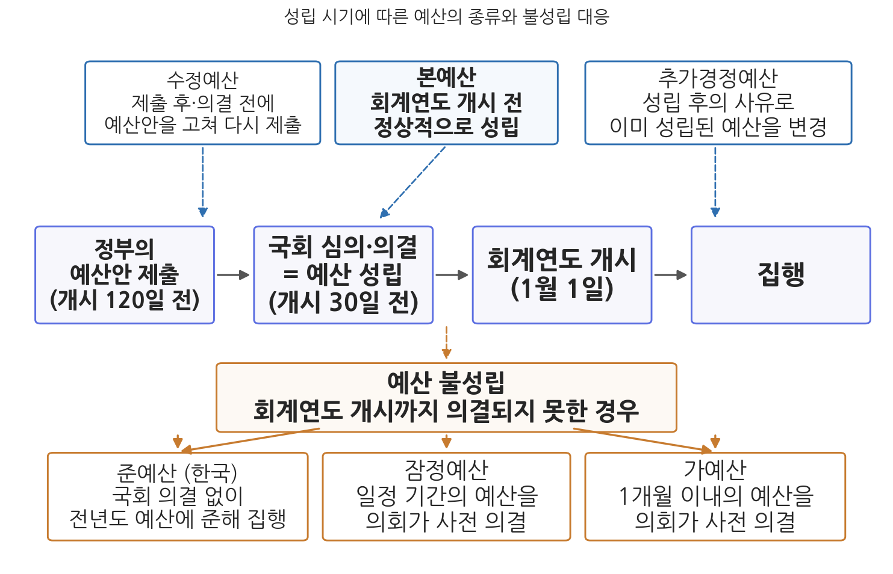
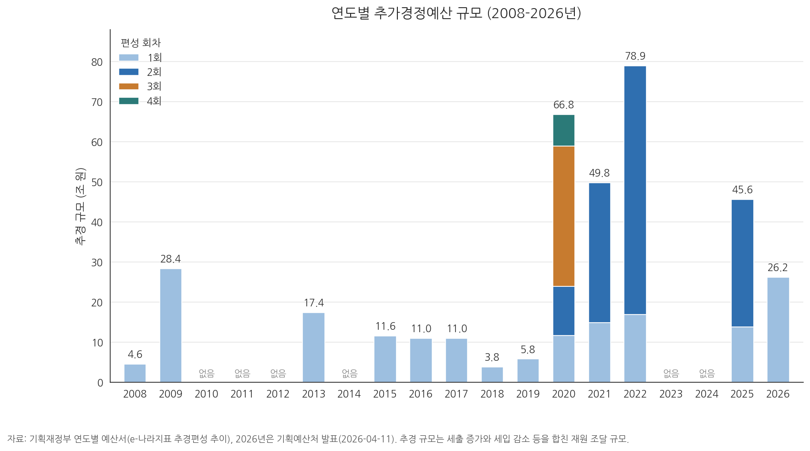
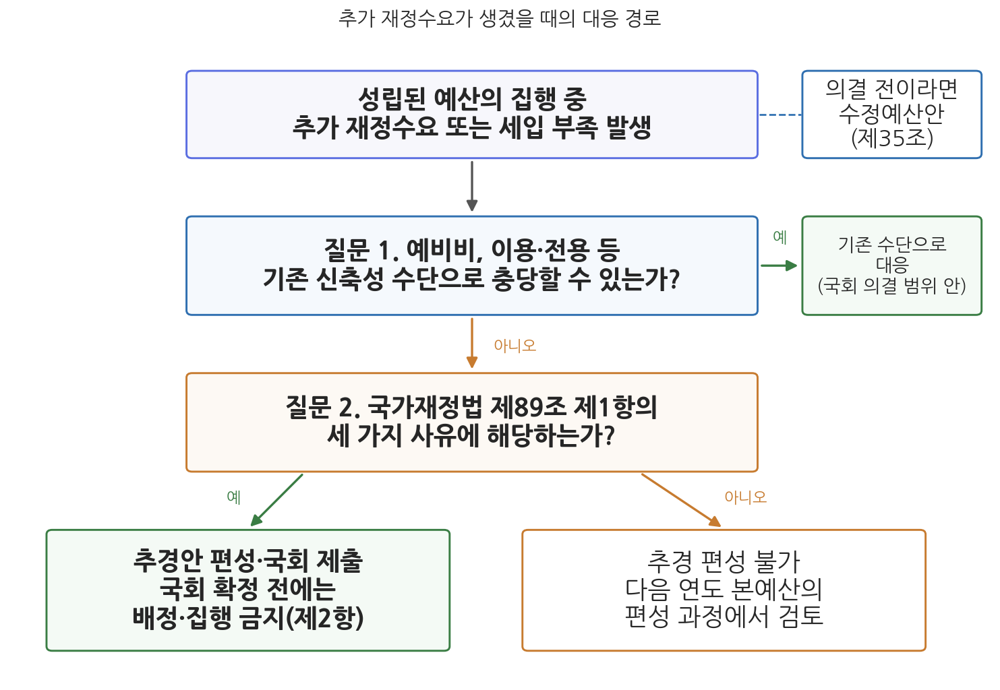
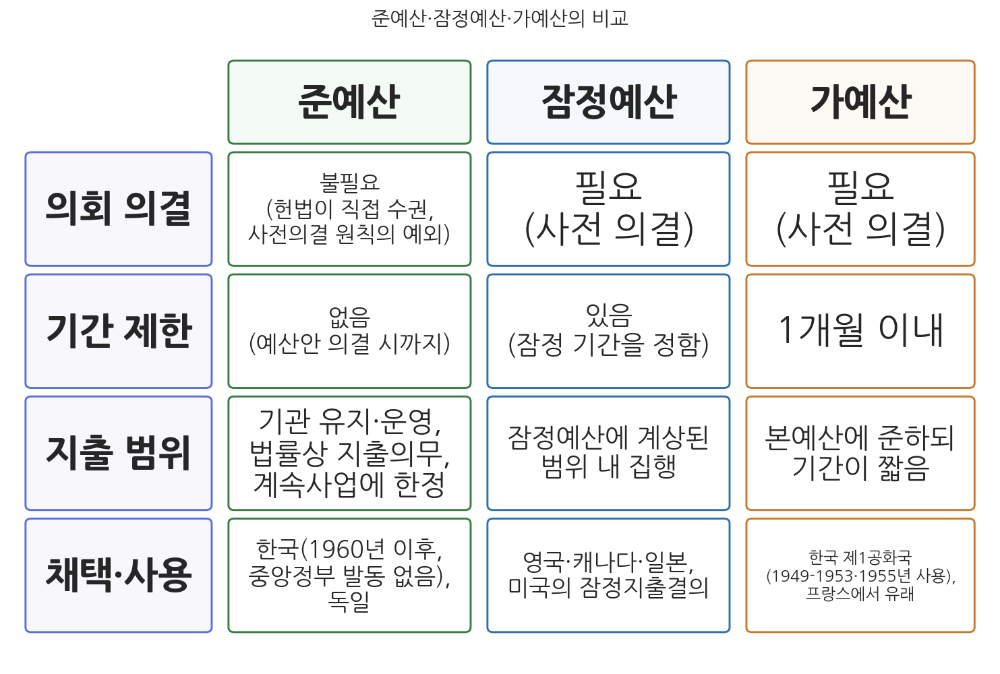

# 6주차 1차시. 예산의 종류: 본예산에서 준예산까지

> 새로운 회계연도가 개시될 때까지 예산안이 의결되지 못한 때에는 정부는 국회에서 예산안이 의결될 때까지 다음의 목적을 위한 경비는 전년도 예산에 준하여 집행할 수 있다.
> (대한민국헌법 제54조 제3항)

## 이 장에서 배우는 것

2026년 4월 11일, 국회는 총 26.2조 원 규모의 추가경정예산(추경)을 확정했다. 2026년 본예산 727.9조 원이 국회를 통과한 지 넉 달 만이다. 중동전쟁발 고유가에 대응해 국민 70%에게 최대 60만 원의 지원금을 지급하고 피해 업종을 지원하는 내용이었다. 한 해 전인 2025년에는 추경이 두 번 있었다. 5월에 산불 등 재해와 통상 환경 변화에 대응하는 13.8조 원, 7월에 새 정부 출범 직후 민생회복 소비쿠폰을 담은 31.8조 원이다. 국회가 연말에 확정한 예산이 "그해의 예산"의 전부가 아닌 것이다. 반대편 극단의 장면도 있다. 2025년 10월 1일 미국 연방정부는 예산이 성립되지 못해 문을 닫았고, 이 셧다운(shutdown)은 43일간 이어져 역대 최장 기록을 세웠다. 예산은 성립된 뒤에 바뀌기도 하고, 아예 제때 성립되지 못하기도 한다. 이 두 방향의 "정상 궤도 이탈"에 제도가 어떻게 대비하고 있는가가 이 장의 주제다.

5주차에서 우리는 하나의 예산이 안으로 어떻게 편제되는지, 곧 세입·세출예산의 과목체계와 프로그램 예산구조를 보았다. 이번 주는 시선을 예산 바깥으로 돌려, 예산이라는 것이 언제 어떤 모습으로 성립하는가에 따라 여러 종류로 나뉜다는 점을 배운다. 기준은 성립의 시기다. 국회 제출 후 의결 전에 고쳐 내는 수정예산, 회계연도 개시 전에 정상적으로 확정되는 본예산, 성립된 뒤에 변경을 가하는 추경이 있고, 회계연도가 시작될 때까지 예산이 성립되지 못하는 비상 상황에 대비한 준예산·잠정예산·가예산이 있다. 구체적으로 다음을 배운다.

- 성립 시기에 따른 예산의 분류: 본예산, 수정예산, 추가경정예산
- 헌법 제56조와 국가재정법 제89조가 추경 편성 사유를 세 가지로 한정한 이유와 조문의 실제 적용
- 2008-2026년 추경의 편성 추이, 규모의 의미(세출과 세입경정), 재원 조달 방식
- 예비비·이용·전용과 추경의 관계, 곧 추가 재정수요가 생겼을 때의 대응 경로
- 예산 불성립에 대비하는 세 제도(준예산·잠정예산·가예산)의 구조와 국가별 채택
- 2009년, 2020년, 2025-2026년의 추경·수정예산 사례와 성남시 준예산, 미국 셧다운 사례 읽기

<strong>이 장의 로드맵</strong> 
이 장은 하나의 질문을 따라 전개된다. <em>"예산이 정상 궤도를 벗어나면, 곧 성립된 뒤에 사정이 바뀌거나 제때 성립되지 못하면 어떻게 되는가?"</em>  
<strong>1.1</strong> 성립 시기에 따른 예산의 분류를 그리고, 본예산과 수정예산을 본다 →
<strong>1.2</strong> 추가경정예산의 법적 요건(헌법 제56조, 국가재정법 제89조)과 2008-2026년의 편성 추이를 뜯어본다 →
<strong>1.3</strong> 예비비·이용·전용과 추경의 관계, 곧 추가 재정수요에 대한 대응 경로를 정리한다 →
<strong>1.4</strong> 예산 불성립에 대비하는 준예산·잠정예산·가예산을 비교한다 →
<strong>1.5</strong> 추경·수정예산·준예산·셧다운의 실제 사례를 읽는다 →
<strong>1.6</strong> 쟁점을 정리하고 2차시(조세지출·성인지 예산과 예산법률주의)로 넘어간다.

## 1.1 본예산과 수정예산

### 성립 시기에 따른 분류

예산은 성립 시기에 따라 본예산, 수정예산, 추가경정예산으로 나뉜다. 기준이 되는 정상 절차부터 확인하자. 헌법 제54조에 따라 정부는 회계연도마다 예산안을 편성해 국회에 제출하고, 국회는 이를 심의·확정한다. 헌법은 회계연도 개시 90일 전까지 제출하도록 정하고 있으나, 국가재정법 제33조는 이를 강화해 120일 전까지 제출하도록 했다. 국회는 회계연도 개시 30일 전, 곧 12월 2일까지 예산안을 의결해야 한다. 2026년 1월 출범한 기획예산처가 예산안편성지침 통보(국가재정법 제29조)와 예산안 편성(제32조)을 관장하고, 국무회의 심의와 대통령 승인을 거쳐 정부가 국회에 제출하는 절차는 1주차에서 본 그대로다. 편성과 심의의 세부 단계는 10주차에서 다시 자세히 다루므로, 이 장에서는 그 절차가 "언제 끝나는가"와 "끝나지 못하면 어떻게 되는가"에 집중한다.

<strong>법조문 읽기 · 대한민국헌법 제54조</strong> 
"① 국회는 국가의 예산안을 심의·확정한다. 
② 정부는 회계연도마다 예산안을 편성하여 회계연도 개시 90일 전까지 국회에 제출하고, 국회는 회계연도 개시 30일 전까지 이를 의결하여야 한다. 
③ 새로운 회계연도가 개시될 때까지 예산안이 의결되지 못한 때에는 정부는 국회에서 예산안이 의결될 때까지 다음의 목적을 위한 경비는 전년도 예산에 준하여 집행할 수 있다. 
1. 헌법이나 법률에 의하여 설치된 기관 또는 시설의 유지·운영 
2. 법률상 지출의무의 이행 
3. 이미 예산으로 승인된 사업의 계속"

이 한 조문에 이 장의 지도가 다 들어 있다. 제1항과 제2항은 예산 성립의 정상 절차다. 정부가 편성하고 국회가 확정하되, 회계연도가 시작되기 전에 끝내야 한다는 시간 규율이 핵심이다. 이 절차를 제때 통과한 예산이 본예산이다. 그리고 제3항은 그 시간 규율이 깨졌을 때, 곧 새 회계연도가 시작됐는데도 예산이 의결되지 못했을 때의 비상 장치다. 이것이 1.4절에서 볼 준예산이다. 헌법 제정자들은 예산이 제때 성립되지 못하는 상황을 미리 내다보고 정부 기능이 멈추지 않을 최소한의 길을 헌법에 새겨 두었다.

<strong>정의 · 본예산, 수정예산, 추가경정예산</strong> 
<strong>본예산</strong>(당초예산)은 정기국회에서 다음 회계연도 예산에 대해 의결·확정한 예산으로, 새로운 회계연도를 위해 최초로 성립된 예산이다. <strong>수정예산</strong>은 정부가 예산안을 국회에 제출한 후 의결·확정되기 전에 부득이한 사유로 그 내용의 일부를 수정해 다시 제출하는 예산안이다(국가재정법 제35조). <strong>추가경정예산</strong>은 예산이 성립된 후에 생긴 사유로 이미 성립된 예산에 변경을 가할 필요가 있을 때 편성하는 예산이다(헌법 제56조, 국가재정법 제89조). 기준선은 예산의 성립 시점이다. 성립 전에 고치면 수정예산, 성립 후에 고치면 추가경정예산이다.

그림 6-1을 읽는 법은 이렇다. 가운데 가로줄이 예산의 시간 흐름이다. 정부가 예산안을 국회에 제출하고, 국회가 의결해 예산이 성립하며, 새 회계연도가 시작되어 집행에 들어간다. 위쪽의 상자들은 이 흐름의 어느 지점에서 개입하는가에 따라 수정예산(제출 후·의결 전), 본예산(정상 성립), 추가경정예산(성립 후 변경)이 갈린다는 것을 보여 준다. 아래쪽 상자는 의결 시점이 회계연도 개시를 넘겨 버린 불성립 상황에서 작동하는 세 제도다. 이 그림에서 알 수 있는 것은 두 가지다. 첫째, 예산의 종류란 별개의 예산이 여럿 있다는 뜻이 아니라 하나의 예산 과정이 어느 지점에서 궤도를 이탈했는가에 대한 분류라는 점이다. 둘째, 제도는 이탈의 모든 지점에 대비책을 두고 있다는 점이다.

### 본예산: 기준선이자 통계의 출발점

본예산은 다른 모든 종류의 예산이 기대는 기준선이다. 수정예산은 본예산이 될 예산안을 고치는 것이고, 추경은 이미 본예산으로 성립한 예산을 고치는 것이며, 준예산은 본예산이 성립할 때까지의 임시 가교다. 본예산은 "당초예산"이라고도 불리는데, 당초라는 말에는 나중에 바뀔 수 있다는 뜻이 함께 들어 있다. 추경이 성립한 해에는 본예산에 추경이 더해져 그해의 실제 예산이 된다. 그래서 같은 연도의 재정 통계라도 "본예산 기준"과 "추경 후 기준"은 다른 숫자를 가리킨다. 이 교재가 총지출 규모를 말할 때 "2026년 본예산 기준 727.9조 원"처럼 기준을 밝히는 것은 이 때문이다. 같은 해에 26.2조 원의 추경이 성립했으므로, 그 해의 재정이 실제로 움직인 규모는 본예산 수치만으로는 알 수 없다.

본예산이 "제때" 성립하는가는 제도의 설계만큼이나 정치의 문제다. 헌법이 정한 12월 2일의 기한은 오랫동안 지켜지지 않았고, 이를 바로잡기 위해 2012년 국회법 개정으로 예산안 자동부의 제도가 도입되었다. 국회법 제85조의3은 위원회가 예산안 심사를 매년 11월 30일까지 마치도록 하고, 기한까지 마치지 못하면 그다음 날 본회의에 부의된 것으로 본다(10주차 2차시에서 자세히 다룬다). 이 제도가 처음 적용된 2015년도 예산안은 12년 만에 법정기한 안에 처리되었고, 2026년도 예산안도 2025년 12월 2일 여야 합의로 처리되어 2021년 이후 5년 만에 법정기한을 지켰다. 본예산의 제때 성립은 이처럼 제도와 정치 일정이 함께 만들어 내는 결과이며, 그 실패의 끝에 1.4절의 준예산이 서 있다.

### 수정예산: 의결되기 전에 고쳐 내는 예산

수정예산은 정부가 예산안을 국회에 제출한 후 예산이 최종 의결되기 전에, 국내외의 사회경제적 여건 변화로 예산안 내용의 일부를 변경할 필요가 있을 때 편성한다. 국가재정법 제35조에 따라 국무회의의 심의를 거쳐 대통령의 승인을 얻어 국회에 제출한다. 이런 제도가 인정되는 이유는 시차에 있다. 예산안 편성 작업은 회계연도가 시작되기 한참 전인 전년도 봄부터 진행되고 국회 제출도 개시 120일 전에 이루어지므로, 편성의 기초가 된 경제 전망과 국회 의결 사이에는 상당한 시간 간격이 존재한다. 그 사이에 경제 위기 같은 큰 변화가 닥치면 이미 제출한 예산안이 낡은 전제 위에 서 있게 되는 것이다.

수정예산이라는 별도의 길이 필요한 이유는 국회의 수정 권한이 제한되어 있기 때문이기도 하다. 헌법 제57조는 "국회는 정부의 동의 없이 정부가 제출한 지출예산 각항의 금액을 증가하거나 새 비목을 설치할 수 없다"고 정한다. 국회가 심의 중에 감액은 자유롭게 할 수 있어도 증액과 신설은 정부의 동의가 있어야 하므로, 지출을 늘리는 방향의 큰 수정이 필요할 때는 정부가 스스로 예산안을 고쳐 다시 내는 편이 합리적이다. 실제로 수정예산안이 제출된 것은 1970년도, 1981년도, 2009년도 예산안 등 손에 꼽을 정도로 드물다. 가장 최근인 2009년도 수정예산안은 2008년 가을 글로벌 금융위기가 터지자 정부가 이미 국회에 제출해 놓은 2009년도 예산안의 지출 규모를 늘려 다시 제출한 것이다. 편성 시점의 전망(안정적 성장)과 의결 시점의 현실(세계적 위기) 사이의 간극을 메운 전형적인 사례다(1.5절에서 자세히 읽는다). 수정예산이 드문 이유는 간단하다. 웬만한 여건 변화는 국회 심의 과정의 증액·감액으로 반영할 수 있고, 예산 성립 후에 터진 변화는 다음에 볼 추경으로 대응할 수 있기 때문이다.

## 1.2 추가경정예산: 요건과 실제

### 예산 단일성 원칙의 예외

추가경정예산(추경)은 예산이 성립된 후에 생긴 사유로 인해 이미 성립된 예산에 변경을 가할 필요가 있을 때 정부가 편성해 국회에 제출하는 예산이다. 헌법 제56조는 "정부는 예산에 변경을 가할 필요가 있을 때에는 추가경정예산안을 편성하여 국회에 제출할 수 있다"고 정해 추경의 헌법적 근거를 마련하고 있다. 2주차 2차시에서 본 예산의 원칙을 떠올려 보자. 예산 단일성의 원칙에 따르면 한 회계연도의 예산은 하나로 통일되어야 하고, 따라서 예산은 본예산에 의해서만 집행되는 것이 원칙이다. 추경은 이 원칙의 예외다. 예외인 만큼 문턱이 있다. 예기치 못한 지출 수요가 생기면 정부는 우선 예비비로 충당하거나 이용·전용 같은 신축성 확보수단(10주차에서 배운다)을 활용하고, 그것으로 감당할 수 없을 때 비로소 추경을 편성하는 것이 제도의 설계다(1.3절에서 이 대응 경로를 자세히 본다). 그리고 추경안이 국회에서 확정되기 전에는 이를 미리 배정하거나 집행할 수 없다(국가재정법 제89조 제2항). 사전의결 원칙은 추경에도 그대로 적용되는 것이다.

문턱은 편성 사유 자체에도 있다. 2006년 제정되어 2007년 시행된 국가재정법은 추경을 편성할 수 있는 경우를 세 가지로 한정했다.

<strong>법조문 읽기 · 국가재정법 제89조(추가경정예산안의 편성)</strong> 
"① 정부는 다음 각 호의 어느 하나에 해당하게 되어 이미 확정된 예산에 변경을 가할 필요가 있는 경우에는 추가경정예산안을 편성할 수 있다. 
1. 전쟁이나 대규모 재해(「재난 및 안전관리 기본법」 제3조에서 정의한 자연재난과 사회재난의 발생에 따른 피해를 말한다)가 발생한 경우 
2. 경기침체, 대량실업, 남북관계의 변화, 경제협력과 같은 대내·외 여건에 중대한 변화가 발생하였거나 발생할 우려가 있는 경우 
3. 법령에 따라 국가가 지급하여야 하는 지출이 발생하거나 증가하는 경우 
② 정부는 국회에서 추가경정예산안이 확정되기 전에 이를 미리 배정하거나 집행할 수 없다."

무슨 뜻인가. 제1항의 문장 구조가 중요하다. "다음 각 호의 어느 하나에 해당하게 되어"라는 요건이 앞에 붙어 있으므로, 세 가지 사유에 해당하지 않으면 정부는 추경안을 편성할 수 없다. 헌법 제56조가 "예산에 변경을 가할 필요가 있을 때"라고만 정한 데 비해, 국가재정법은 그 필요의 범위를 세 가지 사유로 좁혀 재정건전성 규율의 문턱을 세운 것이다. 제89조 제1항은 2009년 2월과 2015년 12월에 개정되었고, 2026년 현재의 조문은 위와 같다. 각 호를 뜯어보면 제1호는 재난(전쟁·대규모 재해), 제2호는 거시경제와 대외 여건의 중대한 변화, 제3호는 법정 지출의 증가다. 특히 제2호는 "발생할 우려가 있는 경우"까지 포함하므로 실제 위기가 닥치기 전의 선제 대응도 허용한다. 뒤집어 말하면 이 요건은 넓게 열려 있는 문이기도 하다. 경기침체의 "우려"는 해석의 여지가 크기 때문에, 요건 조항이 추경을 실제로 얼마나 억제하는가에 대해서는 회의적인 평가가 많다.

### 추경 규모가 뜻하는 것: 세출과 세입경정

추경의 "규모"를 읽을 때는 그 숫자가 무엇을 합친 것인지 먼저 확인해야 한다. 추경은 지출을 늘리는 데만 쓰이지 않는다. 경기가 나빠져 세금이 예상보다 덜 걷히면 본예산의 세입 전망을 낮추어 잡아야 하고, 그만큼 부족해진 재원을 메우는 일도 추경의 몫이 된다.

<strong>정의 · 추경 규모와 세입경정</strong> 
<strong>추경 규모</strong>는 세출 증가와 세입 감소 등에 따른 재원 조달 규모를 뜻한다(e-나라지표 추경편성 추이의 정의). 세출 쪽은 사업을 새로 하거나 늘리는 데 드는 돈이고, 세입 쪽은 본예산의 세입 전망이 줄어 구멍이 난 돈을 메우는 <strong>세입경정</strong>이다. 예를 들어 2025년 제2회 추경 31.8조 원은 세출 증가 21.5조 원과 세입 감소 보전 10.3조 원을 합친 규모다.

이 정의가 중요한 이유는 같은 "규모"라도 경제에 미치는 효과가 다르기 때문이다. 세입경정 부분은 이미 걷히지 않은 세금의 빈자리를 메우는 것이어서 새로운 수요를 창출하지 않는다. 2009년 28.4조 원 가운데 11.2조 원, 2013년 17.4조 원 가운데 12.0조 원, 2020년 제3회 35.1조 원 가운데 11.4조 원이 세입경정이었다. 추경 규모를 연도별로 비교할 때 세출 증가분과 세입경정분을 구별해서 읽어야 하는 까닭이다.

### 추경의 재원과 본예산과의 관계

추경을 편성하려면 돈이 있어야 한다. 추경의 재원은 전년도에 쓰고 남은 세계잉여금, 당해 연도의 세수 증가분, 공기업 주식 매각 수입, 한국은행 잉여금 등으로 마련하며, 이것으로 부족하면 국채를 발행한다. 재원의 성격이 추경의 성격을 좌우한다. 세수가 잘 걷혀 남는 돈으로 하는 추경과 빚을 내서 하는 추경은 재정건전성에 미치는 효과가 전혀 다르기 때문이다. 국회예산정책처의 분석(2025)에 따르면, 2006년 국가재정법 제정 이후 2022년까지 편성된 16회의 추경 가운데 정부안 기준으로 국채를 추가 발행해 재원을 조달한 경우는 9회였다. 나머지는 기금 여유재원, 전년도 세계잉여금, 당해 연도 초과세수, 지출 구조조정으로 마련했으며, 초과세수가 크게 예상될 때는 국채 추가 발행 없이 추경을 편성했다(2016년, 2017년, 2021년 제2회, 2022년 제2회). 최근의 추경은 대체로 국채 발행을 수반했고, 이는 4주차에서 본 국가채무(D1) 증가로 직결되었다. 2025회계연도 결산 기준 국가채무가 1,304.5조 원으로 전년보다 129.4조 원 늘어난 배경에도 두 차례 추경의 재원 조달이 포함되어 있다.

성립 절차의 측면에서 추경은 본예산과 별개로 편성되어 별개로 의결되지만, 일단 성립되면 본예산과 하나로 통합되어 운영된다. 그래서 추경이 있었던 해의 재정 통계는 "본예산 기준"인지 "추경 기준"인지에 따라 달라지며, 연도 간 비교를 할 때는 어느 기준인지 반드시 확인해야 한다. 4주차에서 총지출 규모를 다룰 때 "본예산 기준"이라는 단서를 계속 붙였던 이유가 이것이다.

### 한국의 실제: 거의 해마다 편성되는 추경

제도는 추경을 예외로 설계했지만, 실제의 추경은 예외라기보다 준례에 가깝다. 표 6-1은 국가재정법 시행 이후 편성된 추경을 연도별로 정리한 것이고, 그림 6-2는 같은 자료를 회차별로 쌓아 그린 것이다.

**표 6-1. 연도별 추가경정예산의 편성 내역 (2008-2026년, 단위: 조 원)**

| 연도 | 회차별 규모 | 합계 | 주요 편성 목적 |
|------|------|------|------|
| 2008 | 4.6 | 4.6 | 저소득층 유류비·대중교통 지원, 농어민·중소상인 생활안정 |
| 2009 | 28.4 | 28.4 | 저소득층 생활안정, 고용유지, 중소·수출기업 지원 (글로벌 금융위기 대응) |
| 2013 | 17.4 | 17.4 | 일자리 확충·민생안정, 중소·수출기업 지원, 지역경제 활성화 |
| 2015 | 11.6 | 11.6 | 메르스 대응·피해업종 지원, 가뭄·장마 대책 |
| 2016 | 11.0 | 11.0 | 구조조정 지원, 일자리 창출·민생안정 |
| 2017 | 11.0 | 11.0 | 일자리 창출·여건 개선, 지방재정 보강 |
| 2018 | 3.8 | 3.8 | 청년 일자리 대책, 구조조정지역·업종 대책 |
| 2019 | 5.8 | 5.8 | 미세먼지 대응, 선제적 경기대응·민생경제 지원 |
| 2020 | 11.7 / 12.2 / 35.1 / 7.8 | 66.8 | 코로나19 대응 (방역, 긴급재난지원금, 고용·금융지원, 소상공인 피해지원) |
| 2021 | 14.9 / 34.9 | 49.8 | 소상공인 피해지원, 방역·백신, 고용·민생안정 |
| 2022 | 16.9 / 62.0 | 78.9 | 소상공인 지원, 방역 보강, 법정 지방이전지출 |
| 2025 | 13.8 / 31.8 | 45.6 | 재해·통상 환경 대응, 민생회복 소비쿠폰 |
| 2026 | 26.2 | 26.2 | 고유가 대응, 민생 안정, 피해 업종·기업 지원 |

주. 추경 규모는 세출 증가와 세입 감소 등을 합친 재원 조달 규모이며, 본예산 이후 국회에서 확정된 기준이다. 2010-2012년, 2014년, 2023-2024년은 편성이 없었다. 출처: 기획재정부 연도별 예산서(e-나라지표 추경편성 추이), 국회예산정책처 나보포커스 제89호(2025), 대한민국 정책브리핑(2026).

표와 그림에서 세 가지를 읽을 수 있다. 첫째, 빈도다. 국가재정법이 시행된 2007년부터 2026년 4월까지 20개 연도 가운데 13개 연도에 추경이 편성되었고, 횟수로는 모두 19회다. 둘째, 규모의 비대칭이다. 2015-2019년의 추경은 대체로 4-12조 원 수준이었으나, 코로나19가 닥친 2020년 이후에는 한 해 합계가 45조 원을 넘는 해가 반복되었다. 셋째, 속도다. 국회예산정책처에 따르면 2022년까지의 16회 추경 가운데 14회를 국회가 제출 후 2개월 안에 확정했고, 12회는 상반기에 제출되었다. 본예산이 약 90일의 심의를 거치는 데 비해 추경은 통상 한두 달 안에 결정되는 것이다.

<strong>유의 · 추경의 상시화는 왜 문제인가</strong> 
추경은 예산 단일성 원칙의 예외인데, 예외가 준례가 되면 두 가지 비용이 생긴다. 첫째, <strong>국회 통제의 약화</strong>다. 본예산은 90일 안팎의 심의를 거치지만 추경은 통상 몇 주 만에 처리되므로, 재정의 큰 몫이 짧은 심의로 결정된다. 둘째, <strong>예산 팽창</strong>이다. 추경은 총지출을 늘리는 방향으로 작동하는 것이 보통이고, 국채 발행이 재원이 되면 국가채무가 늘어난다. 그래서 교과서적 처방은 "추경은 자제하는 것이 바람직하다"이지만, 현실은 거의 해마다 추경이다. 제도의 문턱(제89조)과 현실의 빈도 사이의 이 간극을 어떻게 볼 것인가가 토론 문제 6-3의 주제다.

## 1.3 추경의 자리: 예비비·이용·전용과 추경

### 추경은 마지막 수단이다

국회가 의결한 예산은 그대로 집행하는 것이 원칙이지만, 행정은 예측할 수 없는 일을 만난다. 그래서 제도는 추경에 앞서 기존 예산의 틀 안에서 쓸 수 있는 여러 안전판을 두었다. 예비비, 이용·이체, 전용이다. 이 수단들은 모두 국회가 의결한 예산의 범위 안에서 움직이거나, 미리 국회의 의결을 받아 둔 여지를 활용한다는 점에서 추경과 구별된다. 추경은 이 수단들로 감당할 수 없을 때 이미 확정된 예산 자체를 고치는 마지막 수단이다. 표 6-2는 네 수단을 한자리에 놓고 비교한 것이며, 각 수단의 운영 세부는 10주차 2차시에서 다시 다룬다.

**표 6-2. 추가 재정수요에 대한 대응 수단 비교**

| 수단 | 근거 | 무엇을 하는가 | 국회의 관여 | 한계 |
|------|------|------|------|------|
| 예비비 | 헌법 제55조 제2항, 국가재정법 제22조 | 예측할 수 없는 예산 외 지출이나 예산초과지출에 충당 | 총액으로 예산에 계상해 의결, 지출은 차기국회 승인 | 일반회계 예산총액의 100분의 1 이내(사용목적 지정 예비비는 별도) |
| 이용·이체 | 국가재정법 제47조 | 기관 간 또는 장·관·항 간 예산 이동 | 미리 예산으로써 국회의 의결을 얻은 경우에 한정 | 법정 지출의무 이행, 환율·유가 변동, 재해대책 등 열거된 사유 |
| 전용 | 국가재정법 제46조 | 예산의 목적범위 안에서 세항·목 간 금액 이동 | 기획예산처장관 승인(위임 범위는 자체 전용), 분기별 국회에 내역 제출 | 당초 예산에 없는 사업 추진이나 국회 의결 취지와 다른 집행은 불가 |
| 추경 | 헌법 제56조, 국가재정법 제89조 | 이미 확정된 예산 자체를 변경 | 국회의 심의·확정, 확정 전 배정·집행 금지 | 전쟁·대규모 재해, 대내외 여건의 중대한 변화, 법정 지출의 증가 |

주. 이용은 국가재정법 제47조 제1항 단서, 전용의 제한은 제46조 제3항에 따른다. 출처: 대한민국헌법, 국가재정법(2026년 9월 시행 현행).

예비비부터 보자. 국가재정법 제22조 제1항은 정부가 "예측할 수 없는 예산 외의 지출 또는 예산초과지출에 충당하기 위하여 일반회계 예산총액의 100분의 1 이내의 금액을 예비비로 세입세출예산에 계상할 수 있다"고 정한다. 예를 들어 일반회계 예산총액이 500조 원이라면(예시) 계상할 수 있는 예비비는 최대 5조 원이다. 예비비는 헌법 제55조 제2항에 따라 총액으로 국회의 의결을 얻고, 그 지출은 차기국회의 승인을 받아야 한다. 예산을 미리 세부 사업별로 나눌 수 없는 돌발 수요를 위해 총액만 먼저 승인받아 두는 제도인 셈이다. 전용은 사정이 다르다. 국가재정법 제46조 제3항은 "당초 예산에 계상되지 아니한 사업을 추진하는 경우"와 "국회가 의결한 취지와 다르게 사업 예산을 집행하는 경우"에는 전용할 수 없다고 못박는다. 전용은 이미 있는 사업들 사이에서 돈을 옮기는 수단이지 새 사업을 벌이는 수단이 아니라는 뜻이다. 그렇다면 대규모의 새 지원사업은 어떻게 하는가. 예비비의 한도와 "예측할 수 없는" 요건에 들어가지 않으면 결국 추경이 남는다.

### 어느 길로 갈 것인가: 대응 경로

그림 6-3은 이 선택의 논리를 두 개의 질문으로 줄인 것이다. 첫 번째 질문은 예비비, 이용·전용 같은 기존 신축성 수단으로 충당할 수 있는가이고, 충당할 수 있다면 추경은 필요하지 않다. 충당할 수 없다면 두 번째 질문으로 넘어가 국가재정법 제89조 제1항의 세 가지 사유에 해당하는지를 따진다. 해당하면 추경안을 편성해 국회에 제출하되 확정 전에는 배정도 집행도 할 수 없고, 해당하지 않으면 추경 대신 다음 연도 본예산의 편성 과정에서 검토하는 길만 남는다. 예산안이 국회에 제출된 뒤 의결 전이라면 수정예산안(제35조)이 별도의 길로 열려 있다. 이 경로가 실제 운영에서 그대로 지켜지는가는 별개의 문제이지만, 제도의 설계 의도가 "추경은 마지막에"에 있다는 점은 분명하다.

추경이 제출될 때 행정부에는 설명 의무가 하나 더 붙는다. 국가재정법 제7조 제8항은 기획예산처장관이 수정예산안과 추경안이 제출될 때 "재정수지, 국가채무 등 국가재정운용계획의 재정총량에 미치는 효과 및 그 관리방안"을 국회에 보고하도록 정하고 있다. 추경이 5년 단위의 중기 재정계획(10주차 1차시에서 배운다)을 흔들 수 있다는 점을 제도가 인정하고, 그 충격을 국회에 공개하도록 한 것이다. 추경 한 건의 효과를 중기 계획과 함께 읽는 습관이 여기서 출발한다.

## 1.4 예산 불성립과 준예산·잠정예산·가예산

### 예산이 제때 성립되지 못하면

이제 반대 방향의 이탈을 보자. 국회가 회계연도 개시 전까지 예산안을 의결하지 못하면 어떻게 되는가. 1월 1일부터 정부는 지출 근거를 잃는다. 공무원 급여도, 복지 급여도, 진행 중인 공사의 대금도 법적으로는 지급할 수 없게 된다. 이 상황에 대비하는 제도가 나라마다 다르며, 크게 준예산·잠정예산·가예산의 세 유형으로 나뉜다. 한국은 앞서 본 헌법 제54조 제3항의 준예산 제도를 두고 있다. 새로운 회계연도가 개시될 때까지 예산안이 의결되지 못한 때에는, 정부는 국회에서 예산안이 의결될 때까지 헌법이나 법률에 의해 설치된 기관·시설의 유지와 운영, 법률상 지출의무의 이행, 이미 예산으로 승인된 사업의 계속이라는 세 가지 목적의 경비에 한해 전년도 예산에 준하여 집행할 수 있다.

준예산의 제도적 특징은 세 가지다. 첫째, 국회의 의결이 필요 없다. 헌법이 직접 집행을 수권하기 때문이다. 이 점에서 준예산은 2주차 2차시에서 본 사전의결 원칙의 예외다. 둘째, 기간의 제한이 없다. 국회에서 예산안이 의결될 때까지 계속된다. 셋째, 지출 범위가 세 가지 목적으로 한정된다. 신규 사업은 시작할 수 없고, 기존 기관의 유지와 의무지출, 계속사업만 가능하다. 그리고 준예산으로 집행된 예산은 당해 연도의 예산이 확정되면 그 확정된 예산에 의해 집행된 것으로 본다(국가재정법 제55조 제2항). 사후에 본예산 속으로 흡수시켜 회계의 단일성을 회복하는 장치다.

<strong>법조문 읽기 · 국가재정법 제55조(예산불확정 시의 예산집행)</strong> 
"① 정부는 국회에서 부득이한 사유로 회계연도 개시 전까지 예산안이 의결되지 못한 때에는 「헌법」 제54조제3항의 규정에 따라 예산을 집행하여야 한다. 
② 제1항의 규정에 따라 집행된 예산은 해당 연도의 예산이 확정된 때에는 그 확정된 예산에 따라 집행된 것으로 본다."

무슨 뜻인가. 제1항은 헌법의 준예산 조항을 법률 차원에서 받아 집행 의무를 명확히 한 것이고, 제2항은 준예산 기간의 지출을 사후 성립된 본예산의 지출로 간주하는 정산 규정이다. 준예산이 별도의 예산이 아니라 본예산이 성립할 때까지의 임시 가교라는 성격이 여기서 드러난다.

### 준예산으로 무엇이 되고 무엇이 안 되는가

준예산을 "전년도 예산을 그대로 되풀이하는 제도"로 이해하면 오해다. 헌법이 허용하는 것은 세 가지 목적의 경비에 한정되며, 전년도 예산에 "준하여" 집행한다는 것은 전년도 예산을 집행의 기준으로 삼는다는 뜻이다. 예를 들어 공무원 보수와 청사 유지비는 기관의 유지·운영에 해당하고, 국채 이자나 법령에 따라 지급이 정해진 급여는 법률상 지출의무의 이행에 해당하며, 전년도에 시작해 공사 중인 사업은 이미 승인된 사업의 계속에 해당한다. 반면 새해에 새로 시작하려던 사업, 전년도보다 증액하려던 재량 사업은 이 세 범주에 들어가지 않으므로 예산이 의결될 때까지 멈춘다. 준예산의 지출 범위 한정은 국회 의결 없이 돈을 쓰는 것을 최소로 묶어 두기 위한 통제 장치이고, 그 통제가 작동하는 만큼 시민이 체감하는 서비스의 공백도 생긴다(1.5절 성남시 사례).

한 가지 시점을 정확히 해 두자. 본예산은 회계연도 개시 30일 전(12월 2일)까지 국회에서 의결되는 것이 원칙이지만, 이 법정기한을 넘겼다고 곧바로 준예산이 되는 것은 아니다. 준예산은 회계연도 개시일(1월 1일) 전까지 의결되지 못했을 때 비로소 작동한다. 실제로 12월 2일의 법정기한은 자주 지켜지지 않았다. 그러나 법정기한을 넘긴 해에도 연말까지는 예산이 처리되었기에, 1960년 준예산 제도 도입 이래 중앙정부 차원에서 준예산이 실제로 집행된 적은 한 번도 없다.

### 가예산과 잠정예산: 다른 나라의 대비책

한국이 처음부터 준예산이었던 것은 아니다. 제헌헌법부터 제2차 개정 헌법까지는 가예산 제도를 두었다. 예산이 의결되지 못한 때에는 국회가 1개월 이내의 가예산을 의결하고 그 기간 내에 예산을 의결하도록 한 것이다. 가예산은 이용 기간이 1개월로 짧다는 점, 사전에 국회의 의결을 얻어야 한다는 점이 특징이며, 프랑스 제3·4공화국의 잠정 12분의 1 예산제도(매월 본예산안의 12분의 1 범위에서 지출을 승인하는 방식)에서 유래했다. 우리나라는 1949년부터 1953년까지와 1955년에 실제로 가예산을 편성했다. 정부 수립 초기의 정치 혼란 속에서 예산이 제때 성립되지 못하는 일이 잦았던 것이다. 1960년 제3차 개헌에서 준예산 제도로 전환한 뒤 현재에 이른다.

잠정예산은 본예산이 성립될 때까지 일정 기간의 잠정적인 예산을 편성해 의회에 제출하고 의회의 사전 의결을 얻어 사용하는 제도로, 영국·캐나다·일본 등 의원내각제 국가에서 많이 이용된다. 영국은 회계연도가 4월에 시작되는데 본예산 심의가 회계연도 개시 후까지 이어지는 경우가 많아 잠정예산 제출이 관행처럼 되어 있다. 의회의 예산 심의가 정부안을 크게 바꾸지 않는 의원내각제의 특성 때문에, 잠정예산으로 미리 집행해도 큰 문제가 생기지 않는 것이다. 미국의 잠정지출결의(continuing resolution)도 기능상 잠정예산에 해당한다. 미국 의회가 세출법을 제때 통과시키지 못하면 일정 기간 전년 수준의 지출을 허용하는 결의로 다리를 놓는데, 이 다리마저 끊기면 1.5절에서 볼 셧다운이 온다.

그림 6-4를 읽는 법은 이렇다. 세 열이 각각 준예산, 잠정예산, 가예산이고, 세 행이 국회(의회) 의결의 필요 여부, 기간의 제한, 지출 범위의 제한이라는 비교 기준이다. 이 그림에서 알 수 있는 것은 세 제도가 "의회의 통제"와 "정부의 안정적 집행" 사이에서 서로 다른 지점을 선택했다는 점이다. 가예산과 잠정예산은 의회 의결을 요구해 통제를 지키는 대신 그만큼 의회의 협조가 필요하고, 준예산은 의결 없이 자동 작동해 정부 기능의 중단을 확실히 막는 대신 의회 통제가 약해진다. 한국이 준예산을 택한 것은 가예산 시기의 경험, 곧 의회가 가예산조차 제때 의결하지 못할 수 있다는 경험의 산물로 이해할 수 있다.

<strong>왜 한국에서는 셧다운이 일어나지 않는가?</strong> 
미국식 셧다운의 제도적 전제는 두 가지다. 첫째, 예산이 법률(세출법)이어서 의회 통과와 대통령 서명 없이는 한 푼도 지출할 수 없다. 둘째, 예산 불성립 시 자동으로 작동하는 지출 근거가 없다. 한국은 두 전제가 모두 성립하지 않는다. 예산이 법률이 아닐 뿐 아니라(2차시에서 다룬다), 불성립 시 헌법 제54조 제3항이 <strong>자동으로</strong> 최소한의 지출을 수권하기 때문이다. 요컨대 준예산은 셧다운 방지 장치다. 다만 공짜는 아니다. 예산이 늦어져도 정부가 멈추지 않는다는 사실은 국회가 예산 처리를 서두를 유인을 약화시키는 면이 있고, 반대로 미국에서는 셧다운의 고통이 타협을 강제하는 (매우 비싼) 압력으로 작동한다. 제도 설계에는 언제나 맞교환이 있다.

## 1.5 최근 추경·준예산 사례 읽기

### 사례를 읽는 세 가지 질문

지금까지 본 제도가 실제로 작동하는 모습을 사례로 확인하자. 사례를 읽을 때는 세 가지를 물어보면 된다. 어떤 사유로 예산에 손을 댔는가(요건), 그 돈을 어디서 마련했는가(재원), 국회는 얼마나 빨리 어떻게 처리했는가(통제)다. 추경과 수정예산 사례부터 읽고, 이어서 예산 불성립 사례를 읽는다.

### 수정예산과 추경이 함께 동원된 해

<strong>사례 읽기 · 2009년도 수정예산안과 2009년 추경 (2008-2009)</strong> 
정부는 2008년 11월 초, 국제 금융시장 불안으로 세계 경기침체가 확산되어 2009년 경제성장이 당초 전망을 밑돌 가능성이 있다고 보고, 이미 국회에 제출한 2009년도 예산안에 10조 원 규모의 재정지출을 늘리는 수정예산안을 마련했다(지방 사회기반시설, 중소기업·서민 지원 등). 국회예산정책처는 2008년 11월 12일 이 수정예산안(총 283.8조 원)이 그대로 통과되면 외환위기 이후 최대 규모의 재정적자와 역대 최대의 국가채무가 발생한다고 분석했다. 예산이 성립한 뒤에도 위기는 이어져, 정부는 2009년 3월 30일 추경안을 제출했고 국회는 4월 29일 28.4조 원으로 확정했다. 이 가운데 세출 증가가 17.2조 원, 세입경정이 11.2조 원이었다. (출처: 이투데이 2008-11-03, 한국일보 2008-11-14, 국회예산정책처 나보포커스 제89호 2025, e-나라지표 추경편성 추이)

이 사례가 보여 주는 것은 수정예산과 추경이 같은 위기에 대한 시간차 대응이라는 점이다. 예산안이 국회에 있는 동안에는 수정예산안으로 고쳤고, 예산이 성립한 뒤에도 충격이 이어지자 추경으로 다시 고쳤다. 한 회계연도의 예산이 성립 전후로 두 번 조정된 드문 경우이며, 1.1절에서 본 "성립 전이면 수정예산, 성립 후면 추경"이라는 기준선이 현실에서 어떻게 작동하는지 보여 준다. 동시에 28.4조 원 가운데 11.2조 원이 세입경정이었다는 점은, 경기 위축기의 추경에 지출 확대와 세수 결손 보전이 함께 들어 있다는 1.2절의 설명을 확인해 준다.

### 위기 대응의 속도: 2020년 코로나19 추경

<strong>사례 읽기 · 2020년 코로나19 대응 네 차례 추경</strong> 
2020년에는 한 해에 추경이 네 번 편성되었다. 제1회(11.7조 원)는 3월 5일 제출되어 3월 17일 의결되었고 감염병 대응체계 강화와 중소기업·소상공인 회복 지원이 중심이었다. 제2회(12.2조 원)는 4월 16일 제출, 4월 30일 의결로 긴급재난지원금 지급(정부안 기준 7.6조 원)이 핵심이었으며, 기존 사업의 지출 구조조정으로 재원을 마련한 점이 특징이다. 제3회(35.1조 원)는 6월 4일 제출, 7월 3일 의결로 금융지원 패키지와 고용·사회안전망 확충을 담았고 세입경정 11.4조 원이 포함되었다. 제4회(7.8조 원)는 9월 11일 제출, 9월 22일 의결로 소상공인 긴급 피해지원과 고용안전 패키지, 긴급돌봄 지원이 내용이었다. 네 차례의 합계는 66.8조 원이다. (출처: 국회예산정책처 나보포커스 제89호 2025, e-나라지표 추경편성 추이)

이 사례가 보여 주는 것은 위기 국면에서 추경의 속도와 그 반작용이다. 네 차례 모두 제출 후 한 달 안에 의결되었고, 가장 빨랐던 제1회와 제4회는 열흘 남짓 만에 확정되었다. 위기에 대한 제도의 대응성이 작동한 장면이다. 반면 같은 해에 네 번이나 본예산을 고쳤다는 사실은 1.2절 유의 박스의 우려, 곧 짧은 심의로 재정의 큰 몫이 결정된다는 문제를 극단적으로 보여 준다. 재원 측면에서도 국회예산정책처는 2020년의 제1회·제3회·제4회 추경에서 국채를 추가 발행했고 제2회는 지출 구조조정에 의존했다고 분석한다. 같은 추경이라도 재원 조달의 방식이 회차마다 달랐던 것이다.

### 2025-2026년의 세 차례 추경

<strong>사례 읽기 · 2025-2026년의 세 차례 추가경정예산</strong> 
2025년 제1회 추경은 2025년 5월 1일 국회에서 13.8조 원으로 확정되었다(정부안 12.2조 원에서 1.6조 원 순증). 대형 산불 등 재해·재난 대응, 통상 환경 변화와 AI 경쟁력 대응, 민생 지원이 내용이었다. 제2회 추경은 이재명 정부 출범 한 달 만인 2025년 7월 4일 31.8조 원으로 확정되었고(정부안 30.5조 원에서 1.3조 원 순증), 전 국민 민생회복 소비쿠폰 지급이 핵심이었다. 이 31.8조 원은 세출 증가 21.5조 원과 세입경정 10.3조 원을 합친 규모다. 2026년 제1회 추경은 3월 31일 정부안(25.2조 원) 제출 후 4월 11일 26.2조 원으로 확정되었다. 중동전쟁발 고유가 대응, 취약계층 민생 안정, 피해 업종·기업 지원, 공급망 안정이 목적이며 국민 70%에게 최대 60만 원의 고유가 지원금을 지급하는 내용이 담겼다. 2025년의 두 추경은 당시의 기획재정부가, 2026년 추경은 개편으로 예산을 관장하게 된 기획예산처가 편성·발표했다. (출처: 대한민국 정책브리핑 및 기획예산처 보도자료, 2025-2026, e-나라지표 추경편성 추이)

이 사례가 보여 주는 것은 두 가지다. 첫째, 제89조의 요건이 실제로 어떻게 적용되는지다. 산불 피해 대응은 제1호(대규모 재해)에, 고유가·통상 충격과 경기 대응은 제2호(대내·외 여건의 중대한 변화)에 해당한다. 조문의 추상적 사유가 현실의 추경에서 어떤 얼굴로 나타나는지 확인할 수 있다. 둘째, 추경의 정치경제다. 2025년 제2회 추경처럼 새 정부 출범 직후의 추경은 새 정부의 정책 기조(확장재정)를 본예산 주기가 돌아오기 전에 앞당겨 실현하는 수단이 된다. 추경이 경제 충격에 대한 대응인 동시에 정치 일정의 산물이기도 하다는 점은, 11주차에서 볼 예산행태론의 좋은 예습 거리다.

### 예산 불성립의 실제: 셧다운과 지방자치단체의 준예산

이제 반대 방향의 사례로 옮겨 가자. 예산 불성립이 현실이 되었을 때 비용이 어떻게 나타나는지는 미국과 한국의 지방자치단체가 대조적으로 보여 준다.

<strong>사례 읽기 · 미국 연방정부 셧다운 (2018-2019, 2025)</strong> 
미국에서는 세출법과 잠정지출결의가 모두 성립되지 못하면 연방정부가 부분적으로 폐쇄된다. 2018년 12월 22일부터 2019년 1월 25일까지 35일간 이어진 셧다운은 국경장벽 예산을 둘러싼 대통령과 하원의 대치가 원인이었고, 약 80만 명의 연방공무원이 무급휴직되거나 무급으로 근무했다. 이 기록은 2025년에 깨졌다. 2025년 10월 1일 시작된 셧다운은 건강보험 보조금 연장을 둘러싼 여야 대립으로 43일간 이어져 역대 최장 기록을 세웠고, 약 90만 명의 연방공무원이 무급휴직 상태에 놓였다. 상원(68 대 32)과 하원(222 대 209)이 지출 법안을 통과시키고 대통령이 서명한 2025년 11월 12일에야 연방정부는 다시 문을 열었다. (출처: 미국 의회 의결 기록과 언론 보도, 2019·2025)

이 사례가 보여 주는 것은 예산 불성립의 비용이 제도 설계에 따라 얼마나 달라지는가다. 미국은 예산이 법률이고 자동 지출 장치가 없기 때문에, 정치적 대치가 풀리지 않으면 그 비용이 공무원의 급여와 공공서비스의 중단으로 직접 전가된다. 셧다운 기간에 항공관제와 식품 지원 같은 필수 기능까지 흔들린 것은 이 때문이다. 한국의 준예산은 바로 이 시나리오를 봉쇄하는 장치이지만, 한국에서도 준예산의 발동 가능성이 정치적 위협 수단으로 등장하는 일은 드물지 않다. 예산 협상이 연말까지 교착될 때마다 "준예산 사태"라는 말이 언론에 오르내린다.

<strong>사례 읽기 · 성남시의 준예산 사태 (2013)</strong> 
우리나라에서 준예산이 실제로 집행된 드문 사례는 중앙정부가 아니라 지방자치단체에서 나왔다. 성남시의회는 시 산하 도시개발공사 설립을 둘러싼 갈등으로 2012년 12월 정례회와 12월 31일 임시회에서 2013년도 본예산안을 의결하지 못했고, 성남시는 2013년 1월 1일부터 지방자치법상의 준예산 체제에 들어갔다. 이는 지방자치제 실시 이후 처음 있는 일이었다. 준예산 기간에는 법령·조례상 기관·시설의 유지 운영비, 의무지출 경비, 계속사업비만 집행할 수 있어 공공근로사업과 저소득층 지원사업 등 신규 사업 예산이 멈춰 섰고, 언론은 집행하지 못하게 된 예산을 약 1,440억 원으로 보도했다. 준예산 체제는 2013년 1월 7일 시의회가 예산안을 의결하면서 7일 만에 끝났다. (출처: 경기일보·서울신문 보도, 2013)

이 사례가 보여 주는 것은 준예산이 "정부가 멈추지 않는 장치"이지 "정부가 정상 운영되는 장치"가 아니라는 점이다. 단 7일의 준예산으로도 신규 사업과 재량 사업은 전면 중단되었다. 준예산의 지출 범위 한정은 의회 의결 없는 지출을 최소화하기 위한 통제 장치인데, 그 통제가 실제로 작동하면 시민이 체감하는 서비스 공백으로 나타나는 것이다. 헌법과 법률의 조문으로만 보던 제도가 발동되면 어떤 모습인지를 이 작은 사례가 생생하게 보여 준다.

성남시 사례는 중앙정부와 지방자치단체의 제도가 같은 논리로 설계되어 있음도 일러 준다. 현행 지방자치법 제146조는 지방의회에서 새로운 회계연도가 시작될 때까지 예산안이 의결되지 못하면 지방자치단체의 장이 법령이나 조례에 따라 설치된 기관·시설의 유지·운영, 법령상 또는 조례상 지출의무의 이행, 이미 예산으로 승인된 사업의 계속이라는 세 가지 경비를 전년도 예산에 준하여 집행할 수 있다고 정한다. 헌법 제54조 제3항의 세 가지 목적이 그대로 옮겨져 있는 것이다. 추경에서는 오히려 차이가 난다. 지방자치법 제145조 제1항은 "예산을 변경할 필요가 있으면" 추경안을 편성해 지방의회의 의결을 받도록 할 뿐 국가재정법 제89조처럼 사유를 세 가지로 열거하지 않는다. 표 6-3은 이 대응 관계를 정리한 것이다.

**표 6-3. 중앙정부와 지방자치단체의 추경·준예산 규정 비교**

| 구분 | 중앙정부 | 지방자치단체 |
|------|------|------|
| 추경의 근거 | 헌법 제56조, 국가재정법 제89조 | 지방자치법 제145조 |
| 추경의 편성 사유 | 전쟁·대규모 재해, 대내외 여건의 중대한 변화, 법정 지출의 증가로 한정 | "예산을 변경할 필요가 있으면"이라고만 규정 |
| 추경의 의결기관 | 국회 | 지방의회 |
| 예산 불성립 시 근거 | 헌법 제54조 제3항, 국가재정법 제55조 | 지방자치법 제146조 |
| 집행할 수 있는 경비 | 법률에 따른 기관·시설의 유지·운영, 법률상 지출의무의 이행, 승인된 사업의 계속 | 법령·조례에 따른 기관·시설의 유지·운영, 법령상·조례상 지출의무의 이행, 승인된 사업의 계속 |
| 실제 집행 사례 | 1960년 준예산 도입 이후 없음 | 2013년 성남시(7일) |

주. 출처: 대한민국헌법, 국가재정법, 지방자치법(2026년 현행), 경기일보·서울신문(2013).

## 1.6 쟁점과 함의

성립 시기에 따른 예산의 종류는 단순한 분류 지식이 아니라, 예산 과정의 두 가지 긴장을 드러내는 창이다. 첫째 긴장은 안정성과 대응성 사이에 있다. 예산 단일성과 사전의결 원칙은 재정에 대한 의회 통제라는 안정성의 장치이지만, 위기는 예산 주기를 기다려 주지 않는다. 수정예산과 추경은 대응성을 위해 안정성의 원칙에 낸 숨구멍이다. 문제는 숨구멍의 크기다. 추경이 거의 해마다 편성되는 한국의 현실은 예외가 원칙을 잠식하고 있다는 신호로 읽을 수도 있고, 불확실성이 커진 시대에 재정의 대응성이 제도적으로 작동하고 있다는 증거로 읽을 수도 있다. 이 논쟁은 요건의 엄격화 여부로 이어진다. 제89조 제2호가 "우려"까지 포함할 만큼 넓기 때문에 요건을 구체화하거나 국회의 심의 기간을 늘려야 한다는 주장이 있는 반면, 위기는 예측할 수 없으므로 요건을 조이면 오히려 대응이 늦어진다는 반론이 있다. 둘째 긴장은 의회 통제와 정부 기능의 연속성 사이에 있다. 준예산·잠정예산·가예산의 국가별 선택은 이 긴장의 서로 다른 해법이며, 셧다운이라는 미국의 진풍경과 준예산이라는 한국의 안전판은 각 해법의 비용과 편익을 보여 준다.

이 두 긴장 사이에는 연결 고리가 하나 더 있다. 본예산을 편성하는 단계에서 이미 추경을 염두에 둔다는 비판이다. 본예산에 담을 수 있는 사업을 추경으로 미루면 본예산의 심의 기간 동안 받았어야 할 국회의 점검이 짧아진다는 것이 이 비판의 논리다. 이 비판이 어느 정도 타당한지는 사업별로 따져 보아야 하지만, 1.3절의 대응 경로가 "추경은 마지막에"를 전제로 설계되어 있다는 점을 기준으로 삼을 수 있다. 예비비·이용·전용으로 닿지 않는 수요이고 제89조의 사유에 해당한다는 두 조건을 모두 충족해야 추경이 정당화되기 때문이다. 세입경정 추경도 같은 틀에서 읽어야 한다. 세수가 예상보다 덜 걷혔을 때 그 구멍을 국채나 기금으로 메우는 추경은 지출 확대와 성격이 다르며, 재정건전성의 관점에서는 별도로 평가해야 한다.

이 장에서 본 예산의 종류들은 모두 "세입·세출예산"이라는 예산의 본체를 전제로 한 분류였다. 그런데 정부가 정책 목적을 달성하는 수단에는 예산서에 지출로 잡히지 않는 것도 있다. 세금을 깎아 주는 방식의 지원, 곧 조세지출이다. 또 예산의 본체에 붙어 예산이 특정 가치(성평등, 온실가스 감축)에 미치는 영향을 분석하는 서류들도 있다. 그리고 이 모든 것의 바탕에는 "예산은 도대체 법적으로 무엇인가"라는 근본 질문이 있다. 2차시에서 이 세 가지를 다루면 재정의 구조를 다루는 2부가 마무리된다.

예산의 종류를 구분할 때는 재원이 더 필요한 이유에 앞서 예산이 어느 단계에 있는지를 확인해야 한다. 정부가 국회에 예산안을 제출한 뒤 아직 의결되기 전에 내용을 바꿀 필요가 생겼다면 수정예산안의 문제다. 본예산이 이미 성립한 뒤 지출을 추가하거나 변경하려면 먼저 예비비·이용·전용으로 닿는지 보고, 닿지 않을 때 추경의 법정 요건과 절차를 검토한다. 같은 재난 대응이라도 발생 시점에 따라 사용할 문서와 절차가 달라질 수 있다. 추경은 본예산과 별개의 두 번째 살림이 아니라, 성립한 예산의 일부를 바꾸는 예산이라는 점도 함께 기억해야 한다.

준예산은 이와 다른 상황에 대응한다. 새 회계연도가 시작되었는데 예산안이 아직 의결되지 않았을 때, 헌법이 정한 경비에 한해 전년도 예산에 준하여 집행할 수 있게 하는 장치다. 전년도 예산 전체를 자동으로 되풀이하는 임시 예산으로 이해해서는 안 된다. 예산이 뒤늦게 성립한 경우에는 그동안 집행한 경비와 새로 확정된 예산의 관계를 정리해야 한다. 예산의 종류는 단순한 이름 목록이 아니라, 성립 전 변경·성립 후 변경·미성립 상태라는 서로 다른 문제에 대한 제도적 답이다. ([헌법 제54조](https://www.law.go.kr/법령/대한민국헌법/제54조), [국가재정법 제35·89조](https://www.law.go.kr/법령/국가재정법))

## 요약

예산은 성립 시기에 따라 본예산, 수정예산, 추가경정예산으로 나뉜다. 본예산은 정기국회에서 다음 회계연도에 대해 의결·확정한 최초의 예산으로 모든 예산 종류의 기준선이며, 수정예산은 국회 제출 후 의결 전에 예산안을 고쳐 다시 제출하는 것으로 1970년도·1981년도·2009년도 예산안 등 드물게만 제출되었다. 추가경정예산은 예산 성립 후의 사유로 예산을 변경하는 제도로 예산 단일성 원칙의 예외이며, 헌법 제56조에 근거하고 국가재정법 제89조는 편성 사유를 전쟁·대규모 재해, 대내외 여건의 중대한 변화, 법정 지출의 증가라는 세 가지로 한정하고 확정 전 배정·집행을 금지한다. 추경 규모는 세출 증가와 세입경정을 합친 재원 조달 규모이며, 2007년 이후 2026년 4월까지 20개 연도 중 13개 연도(19회)에 추경이 편성되어 2020년 66.8조 원, 2022년 78.9조 원, 2025년 45.6조 원(13.8조 원·31.8조 원), 2026년 26.2조 원에 이르렀다. 추경은 예비비, 이용·전용 같은 기존 신축성 수단으로 충당할 수 없고 제89조의 사유에 해당할 때 편성하는 마지막 수단으로 설계되어 있으며, 그럼에도 거의 해마다 편성되어 국회 통제 약화와 예산 팽창의 우려가 제기된다. 예산이 회계연도 개시 전까지 성립되지 못하는 경우에 대비한 제도로는 준예산·잠정예산·가예산이 있다. 한국의 준예산(헌법 제54조 제3항)은 국회 의결 없이 기관 유지·운영, 법률상 지출의무 이행, 승인된 사업의 계속에 한해 전년도 예산에 준한 집행을 허용하며, 1960년 도입 이후 중앙정부에서 발동된 적은 없으나 2013년 성남시에서 지방 차원의 준예산이 7일간 집행된 사례가 있다. 가예산은 국회가 1개월 이내의 예산을 사전 의결하는 제도로 제1공화국에서 사용되었고, 잠정예산은 영국 등 의원내각제 국가에서 관행화된 사전 의결형 임시예산이다. 예산이 법률이고 자동 지출 장치가 없는 미국은 세출법 불성립 시 셧다운을 겪으며, 2025년의 셧다운은 43일로 역대 최장이었다.

## 토론·복습 문제

**6-1. (서술형 연습)** 준예산, 잠정예산, 가예산을 국회(의회) 의결의 필요 여부, 기간 제한, 지출 범위의 세 기준으로 비교하여 설명하고, 한국이 가예산 제도에서 준예산 제도로 전환한 배경을 서술하시오.

**6-2. (조문 적용형)** 다음 각 상황이 국가재정법 제89조 제1항의 어느 호에 해당하는지(또는 어느 호에도 해당하지 않는지) 판단하고 근거를 제시하시오. (가) 대규모 산불로 특별재난지역이 선포되어 복구 재원이 필요한 경우, (나) 유가 급등으로 경기 하강의 우려가 커져 민생 지원이 필요한 경우, (다) 집권당이 총선 공약 이행을 위해 신규 사업 재원이 필요한 경우.

**6-3. (찬반 토론)** "추경의 상시화는 국회의 재정 통제를 약화시키므로 국가재정법 제89조의 편성 요건을 더 엄격하게 개정해야 한다"는 주장에 대해, 표 6-1과 2025-2026년의 추경 사례를 논거로 활용하여 찬성과 반대 입장을 각각 구성하고 자신의 입장을 정하시오.

**6-4.** 미국의 2025년 셧다운(43일)과 한국의 준예산 제도를 비교하여, 예산 불성립 시 자동 지출 장치의 존재가 (가) 정부 기능의 연속성과 (나) 의회의 예산 심의 유인에 각각 어떤 영향을 미치는지 분석하시오.

**6-5. (계산·해석형)** 표 6-1에 따르면 2025년 추경은 제1회 13.8조 원과 제2회 31.8조 원이고, 2025년 본예산 총지출은 673.3조 원이다. (가) 두 추경의 합계를 구하고 본예산 대비 비율을 소수 첫째 자리까지 계산하시오. (나) 제2회 추경 31.8조 원이 세출 증가 21.5조 원과 세입경정 10.3조 원으로 이루어져 있다고 할 때, 세입경정이 무엇이며 왜 추경 규모를 해석할 때 세출 증가분과 구별해야 하는지 설명하시오. (다) (가)의 비율을 그대로 "추가 지출의 비중"으로 읽으면 어떤 오해가 생기는지 서술하시오.

**6-6. (적용형)** 그림 6-3의 두 질문을 사용하여 다음 상황에 적합한 대응 수단을 고르고 이유를 제시하시오(수치는 예시). (가) 한 부처의 A사업비가 200억 원 부족하고 같은 부처 B사업에서 200억 원의 불용이 예상되는 경우, (나) 예측하지 못한 재해로 긴급 복구비 3조 원이 필요한데 예비비 잔액이 5,000억 원뿐인 경우, (다) 새로 도입하려는 소득지원 사업이 당초 예산에 없고 재해나 경기침체와는 무관한 경우. 또한 2009년처럼 예산안이 아직 국회에서 의결되지 않은 상태라면 어떤 길이 추가로 열리는지 답하시오.
