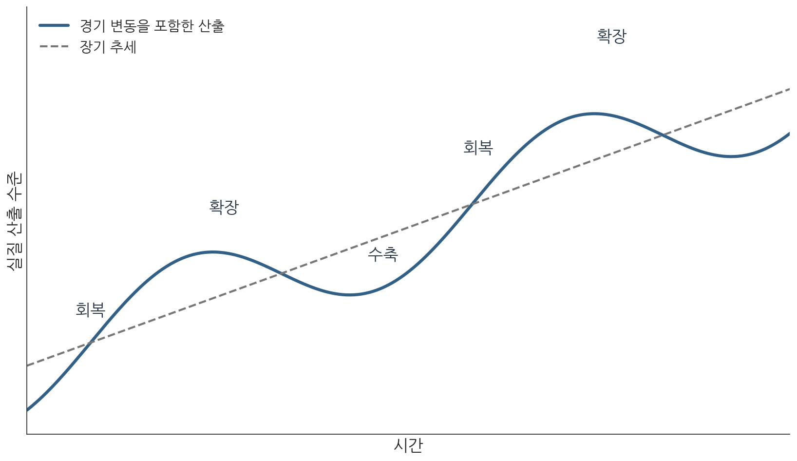
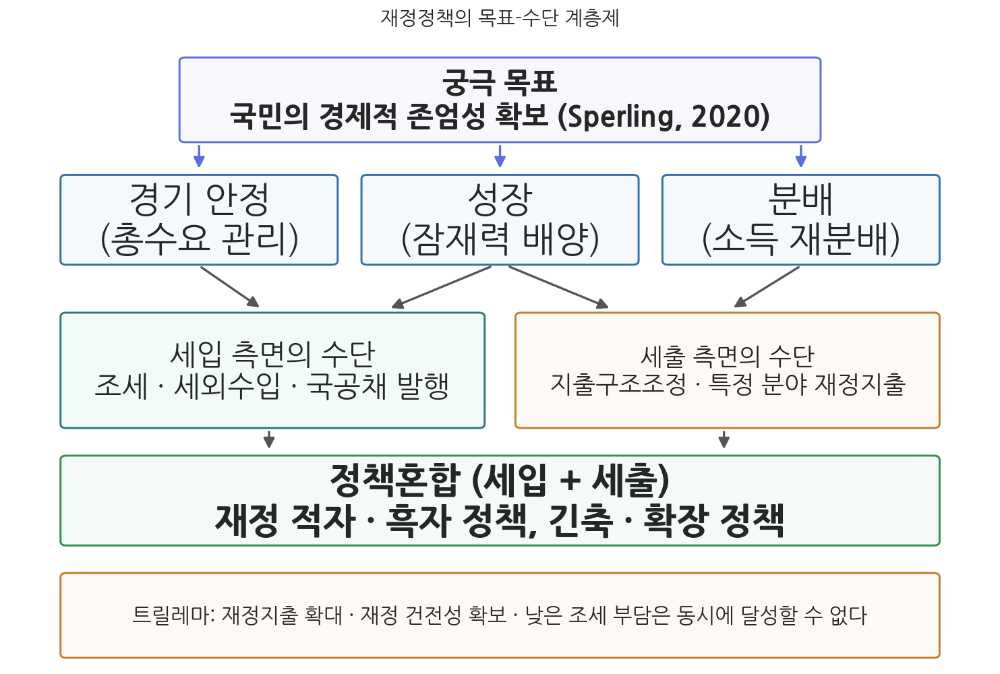
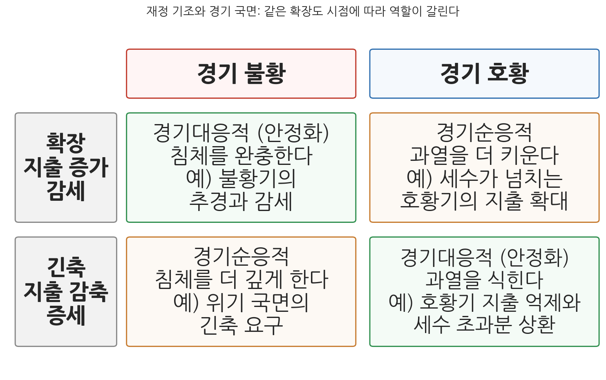
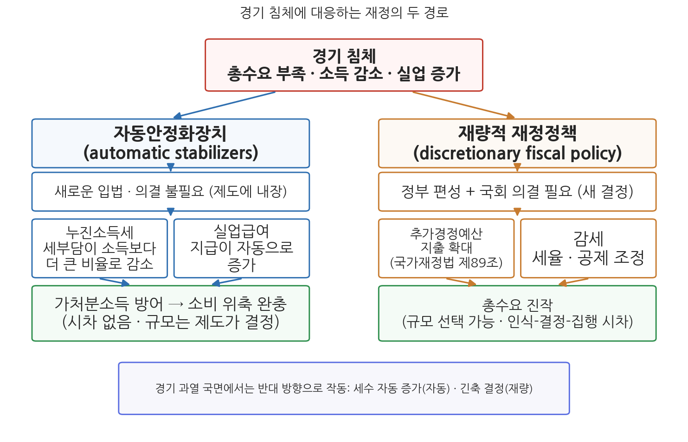
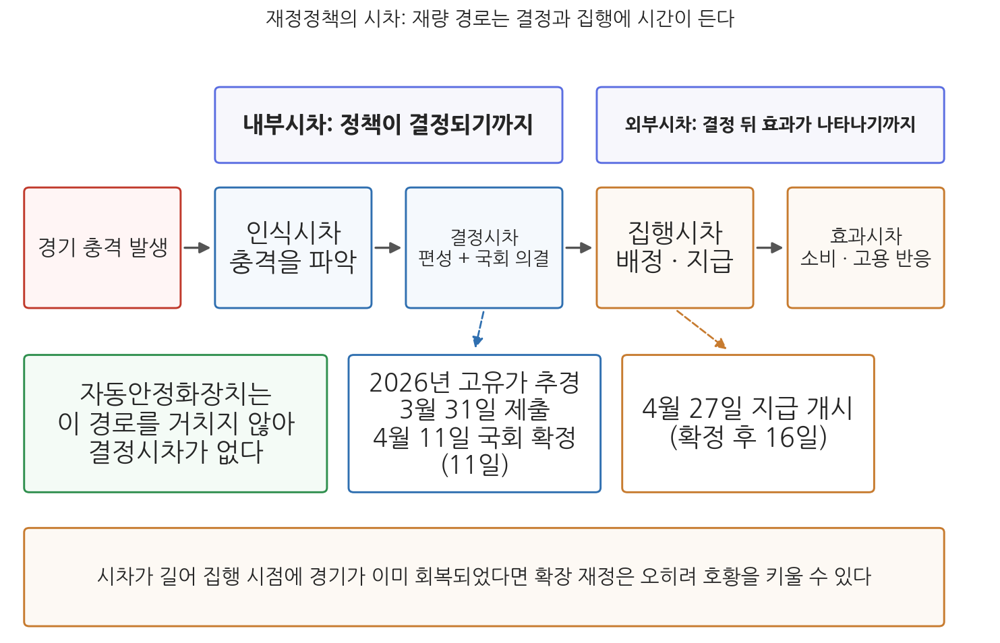
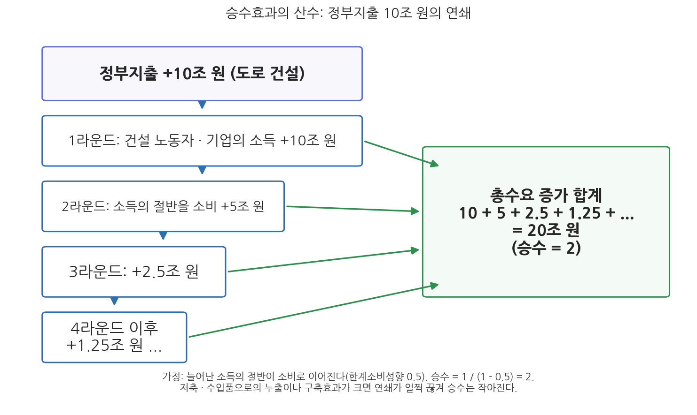

# 7주차 1차시. 재정정책의 구조와 유형

> 호황이야말로, 불황이 아니라, 재무부가 긴축에 나설 적기다.
> (존 메이너드 케인스, 「어떻게 불황을 피할 것인가」, 더 타임스, 1937)

## 이 장에서 배우는 것

2026년 봄의 재정 일지를 따라가 보자. 중동전쟁발 고유가가 민생을 덮치자 정부는 3월 31일 25조 2,000억 원 규모의 추가경정예산(추경)안을 국회에 제출했고, 국회는 열하루 만인 4월 11일 이를 26조 2,000억 원으로 늘려 확정했다. 국민 70%에게 최대 60만 원의 고유가 지원금을 지급하는 사업은 4월 27일부터 집행에 들어갔다. 제출에서 지급까지 한 달이 걸리지 않은, 정부와 국회가 내린 빠른 결정이었다. 그런데 같은 봄, 아무도 결정하지 않았는데 이미 움직이고 있던 재정도 있다. 경기가 나빠져 소득이 줄어든 사람의 소득세 부담은 누진세 구조 때문에 소득보다 더 큰 비율로 자동으로 줄었고, 일자리를 잃은 사람에게는 실업급여가 자동으로 지급되기 시작했다. 하나는 정부가 그때그때 결정하는 재정이고, 다른 하나는 제도에 미리 심어 둔 재정이다. 이 두 얼굴을 구분하는 것이 이 장의 출발점이다.

이번 주부터 교재는 새로운 부로 넘어간다. 3주차부터 6주차까지의 2부에서 우리는 재정의 구조, 곧 회계와 기금, 통합재정과 총지출, 과목체계, 예산의 종류라는 나라 살림의 뼈대를 보았다. 7주차와 9주차의 3부는 재정정책론이다. 이제 질문이 바뀐다. 재정이 어떻게 생겼는가가 아니라, 정부가 재정이라는 수단으로 경제에 무엇을 할 수 있고 무엇을 해야 하는가를 묻는다. 2주차 1차시에서 본 재정의 네 기능 가운데 경제안정화 기능이 이 장의 주인공이다. 구체적으로 다음을 배운다.

- 저성장, 고령화, 불평등이라는 재정환경의 변화와 경기 순환 속에서 재정이 맡는 안정화 역할
- 재정정책의 목표-수단 구조와 트릴레마, 그리고 재정 기조를 읽는 지표(구조적 재정수지, 재정충격)
- 자동안정화장치와 재량적 재정정책의 구분, 한국 자동안정화장치의 크기
- 재량적 재정정책의 시차와 법적 통로(국가재정법 제89조), 2025-2026년의 세 차례 추경
- 확장적 재정정책의 논리(승수효과, 지출과 감세의 차이)와 구축효과의 반론, 2026년 본예산의 확장 기조
- 실업의 세 종류와 유형별 처방, 실업급여, 그리고 AI 시대의 과제

<strong>이 장의 로드맵</strong> 
이 장은 하나의 질문을 따라 전개된다. <em>"정부는 재정으로 경기에 어떻게 대응하는가, 그리고 그 대응은 어떤 논리로 정당화되고 어떤 반론에 부딪히는가?"</em>  
<strong>1.1</strong> 재정환경의 변화와 경기 순환 속 재정의 역할을 확인한다 →
<strong>1.2</strong> 재정정책의 목표-수단 구조를 그리고 재정 기조를 읽는 법을 익힌다 →
<strong>1.3</strong> 자동안정화장치와 재량적 재정정책을 구분하고 한국의 위치를 확인한다 →
<strong>1.4</strong> 재량 정책의 시차와 법적 통로(추경)를 사례로 읽는다 →
<strong>1.5</strong> 확장적 재정정책의 논리(승수효과)와 반론(구축효과)을 산수 수준에서 뜯어본다 →
<strong>1.6</strong> 실업의 종류에 따라 처방이 어떻게 달라지는지 보고, 다음 차시의 새로운 실험들을 예고한다.

## 1.1 재정환경의 변화와 재정의 대응

### 재정이 마주한 세계: 저성장, 고령화, 불평등

오늘날의 재정정책은 반세기 전보다 훨씬 무거운 짐을 지고 있다. 짐은 세 방향에서 온다. 첫째, 소득과 자산의 불평등 구조다. 중산층이 얇아지고 일해도 가난한 신빈곤층이 늘어나며 가계부채가 쌓이는 구조에서는, 시장의 분배 결과를 재정이 사후에 교정해야 한다는 요구가 커진다. 둘째, 저출산과 고령화의 인구구조 변화다. 한국의 합계출산율은 세계 최저 수준까지 떨어졌고 생산가능인구는 이미 줄고 있다. 세금을 낼 사람은 줄고 복지지출을 받을 사람은 늘어나는 구조 변화는 세입과 세출 양쪽에서 재정을 압박한다. 셋째, 저성장과 고용 없는 성장이다. 성장률 자체가 낮아진 데다, 성장이 고용으로 이어지는 고리가 약해졌고, AI(인공지능)에 의한 일자리 대체 우려까지 더해졌다. 긴축과 비정규직 확산, 과도한 노동시간이 겹치면 경제 전체의 총수요가 부족해지고 삶의 질이 낮아진다는 진단이 뒤따른다.

이 요구들 앞에서 재정은 무한한 수단이 아니다. 재정은 건전성과 지속가능성이라는 제약조건을 가지므로, 모든 문제에 적극적으로 대응하는 데에는 한계가 있다. 4주차에서 본 국가채무(D1)와 관리재정수지를 떠올려 보자. 지출 요구는 늘 세입 능력보다 크고, 그 간극은 국채 발행으로 메워지며, 쌓인 채무는 미래의 재정 여력을 잠식한다. 재정정책론의 모든 논쟁은 결국 "무엇을 위해 얼마나 쓸 것인가"와 "그 대가를 어떻게 감당할 것인가" 사이의 긴장에 관한 것이다.

### 경기는 순환하고, 재정은 그 순환에 대응한다

시장경제의 생산은 일정한 속도로 늘어나지 않고 호황과 불황을 되풀이하며 장기 추세의 위아래를 오르내린다. 경기가 좋아 생산과 고용이 잠재 수준을 웃돌면 물가가 오르고 과열의 부작용이 쌓이며, 경기가 나빠 잠재 수준을 밑돌면 기업은 생산을 줄이고 가계는 일자리와 소득을 잃는다. 이 순환의 폭을 줄이는 것이 2주차 1차시에서 본 재정의 경제안정화 기능이고, 그 기능을 수행하는 수단이 재정정책이다. 시장이 스스로 균형을 회복하기를 기다리면 그 사이에 치르는 실업과 폐업의 비용이 너무 크다는 것이 케인스 이래 재정정책을 정당화하는 기본 논리다(Keynes, 1936). 이 장 첫머리의 인용문이 긴축을 호황기에 권하는 까닭도 여기에 있다. 재정의 안정화 역할은 불황에 돈을 푸는 것만이 아니라 호황에 거두어들이는 것까지 포함하기 때문이다.

**그림 7-1. 장기 추세와 경기의 순환**

재정이 이 순환에 대응하는 데에는 두 가지 어려움이 따른다. 하나는 경기의 국면을 실시간으로 정확히 알 수 없다는 점이다. 잠재 수준이 얼마인지는 눈에 보이지 않는 추정치이고, 경기지표는 사후에 집계되어 발표된다. 다른 하나는 재정이 경기 변동에 대응하는 동시에 경기 변동에 영향을 받는다는 점이다. 불황에는 세수가 줄고 호황에는 세수가 늘어, 재정의 모습 자체가 경기에 따라 달라진다. 이 두 어려움이 이 장의 1.2절(재정 기조의 측정)과 1.4절(정책의 시차)에서 각각 구체적인 문제로 나타난다.

## 1.2 재정정책의 구조와 재정 기조

### 재정정책의 목표-수단 구조

재정정책은 하나의 숫자가 아니라 방향을 가진 선택이다. 재정의 총량이 크다 작다만 보아서는 정책을 읽을 수 없고, 어떤 목표를 향해 어떤 수단을 배열했는가라는 목표-수단의 계층제로 보아야 한다. 재정정책의 궁극 목표를 국민의 경제적 존엄성 확보로 규정하는 논의도 있다(Sperling, 2020). 그 아래에 경기 안정, 성장, 분배 같은 중간 목표가 놓이고, 다시 그 아래에 구체적 수단이 배열된다. 세입 측면의 수단으로는 조세, 세외수입, 국공채 발행이 있고, 세출 측면의 수단으로는 지출구조조정과 특정 분야에 대한 재정지출이 있다. 세입과 세출을 묶은 정책혼합으로는 재정적자 정책과 흑자 정책, 긴축정책과 확장정책이 있다. 그림 7-2는 이 계층을 한눈에 보여 준다.

<strong>정의 · 재정정책</strong> 
<strong>재정정책</strong>(fiscal policy)은 정부가 조세(세입)와 정부지출(세출)을 수단으로 총수요와 자원배분에 영향을 미쳐 경기의 안정, 성장, 분배 등의 목표를 달성하려는 정책이다. 통화량과 금리를 수단으로 하는 통화정책(monetary policy)과 함께 거시경제정책의 두 축을 이룬다. 통화정책과의 관계는 9주차 2차시에서 다룬다.

목표들 사이에는 동시에 달성하기 어려운 조합이 있다. 재정지출의 확대, 재정 건전성의 확보, 낮은 조세 부담이라는 세 목표는 트릴레마(trilemma)의 관계에 있다. 지출을 늘리면서 세금을 올리지 않으면 건전성이 무너지고, 지출을 늘리면서 건전성을 지키려면 증세가 필요하며, 세금도 안 올리고 건전성도 지키려면 지출을 늘릴 수 없다. 어느 두 개를 잡으면 나머지 하나를 놓아야 하는 이 구조에서, 무엇을 우선할 것인가가 바로 재정정책의 정치적 선택이다. 최근 한국의 선택이 지출 확대 쪽으로 기울어 있다는 점은 1.5절의 수치에서 확인할 것이다.

이 선택이 자의적인 것만은 아니다. 헌법은 국가가 경제의 안정을 위해 개입할 수 있는 근거를 명시하고 있다.

<strong>법조문 읽기 · 헌법 제119조제2항</strong> 
"국가는 균형있는 국민경제의 성장 및 안정과 적정한 소득의 분배를 유지하고, 시장의 지배와 경제력의 남용을 방지하며, 경제주체간의 조화를 통한 경제의 민주화를 위하여 경제에 관한 규제와 조정을 할 수 있다."

무슨 뜻인가. 제119조제1항이 개인과 기업의 경제적 자유를 경제질서의 기본으로 선언한 뒤에, 제2항은 성장과 안정, 적정한 소득분배를 위한 국가의 규제와 조정 권한을 인정한다. 경기가 침체하면 재정을 풀어 안정시키고, 분배가 악화되면 재정으로 교정하는 활동은 이 조항이 말하는 규제와 조정의 대표적 형태다. 이 장에서 다루는 경기대응 재정정책과 다음 차시에서 다룰 분배 실험들은 모두 헌법의 이 문장 위에 서 있다.

중앙정부에서 이 선택을 설계하는 기관은 2026년 정부조직 개편 이후 둘로 나뉜다. 예산의 편성과 재정정책의 수립은 기획예산처가, 세제와 국고, 경제정책의 총괄은 재정경제부가 맡는다. 재정정책이 세출과 세입의 조합이라는 점을 떠올리면, 재정 기조는 두 부처의 소관이 겹치는 영역에서 결정되는 셈이다.

### 재정 기조는 어떻게 읽는가

같은 재정이 확장인지 긴축인지는 생각보다 판정하기 어렵다. 가장 손쉬운 지표는 재정수지이지만, 재정수지는 정부의 결정만이 아니라 경기에도 좌우된다. 불황이 오면 세수가 줄고 실업급여 같은 지출이 늘어 정부가 아무것도 바꾸지 않았는데도 적자가 커진다. 이 적자를 확장정책의 결과로 읽으면 오판이다. 반대로 호황기에 세수가 넘쳐 흑자가 나더라도 그것이 정부가 긴축을 선택했다는 증거는 아니다. 그래서 재정 기조를 읽으려면 경기의 영향을 걷어내고 정부의 선택만 남기는 작업이 필요하다.

이 작업에 쓰이는 대표적 지표가 구조적 재정수지(cyclically adjusted balance)다. 경기가 잠재 수준에 있다고 가정하고 다시 계산한 재정수지로, 국제기구와 각국의 예산기구가 재정 기조를 평가할 때 쓴다. 구조적 재정수지가 전년보다 나빠졌다면 경기와 무관하게 정부가 세입을 줄이거나 지출을 늘렸다는 뜻이며, 이 변화의 크기를 흔히 재정충격(fiscal impulse)이라 부른다. 다만 이 지표들은 잠재 GDP를 추정해야 계산되므로 추정 방법에 따라 값이 달라진다는 한계가 있다. 표 7-1은 재정 기조를 읽는 네 지표의 성격을 비교한 것이다.

**표 7-1. 재정 기조를 읽는 네 가지 지표**

| 지표 | 무엇을 보는가 | 장점 | 한계 |
|------|---------------|------|------|
| 총지출 증가율 | 예산 규모가 전년보다 얼마나 늘었는가 | 계산이 쉽고 예산안 발표와 함께 바로 나온다 | 물가, 인구, 자동으로 늘어나는 지출과 새 정책을 구분하지 못한다 |
| 재정수지(통합재정수지, 관리재정수지) | 세입과 세출의 차이가 GDP 대비 얼마인가 | 국가채무와 직결되어 건전성 판단에 쓰인다 | 경기에 따라 저절로 변해 정부의 선택과 섞인다 |
| 구조적 재정수지 | 경기의 영향을 제거한 재정수지 | 정부의 재량적 선택만 골라 볼 수 있다 | 잠재 GDP 추정에 따라 값이 달라진다 |
| 재정충격 | 구조적 재정수지가 전년보다 얼마나 변했는가 | 해당 연도의 재정이 경기를 밀었는지 눌렀는지 드러낸다 | 구조적 재정수지의 추정 오차를 그대로 물려받는다 |

기조의 방향은 경기 국면과 맞물려 읽어야 한다. 확장은 불황에서는 침체를 완충하지만 호황에서는 과열을 키우고, 긴축은 호황에서는 과열을 식히지만 불황에서는 침체를 깊게 한다. 그림 7-3은 이 네 조합을 정리한 것이다. 경기와 같은 방향으로 움직여 변동을 증폭시키는 경기순응적 운용을 피하고 반대 방향으로 움직이는 경기대응적 운용을 하라는 것이 안정화정책의 기본 요구다. 세수가 넘치는 호황기에 지출을 함께 늘리는 관행이 재정준칙 논의의 한 배경이라는 점은 9주차 1차시에서 다시 다룬다.

### 한국의 실제: 총지출 증가율만으로는 기조를 읽을 수 없다

한국에서 재정 기조를 말할 때 가장 자주 쓰이는 지표는 총지출 증가율이다. 열린재정 기준 본예산 총지출은 2015년 375조 4,000억 원에서 2025년 673조 3,000억 원으로 10년간 약 1.8배, 연평균 약 6% 늘었다(출처: 열린재정, 본예산 기준). 이 숫자는 재정이 꾸준히 커졌음을 말해 주지만 어느 해의 기조가 확장이었는지는 말해 주지 않는다.

재정정책의 방향은 예산 증가율 하나로 판정하기 어렵다. 물가와 인구가 오르면 종전의 서비스 수준을 유지하는 데에도 더 많은 명목 예산이 필요하다. 반대로 명목 지출이 늘어도 실질 구매력이 줄 수 있고, 세법을 바꾸지 않아도 경기 회복으로 세수가 늘 수 있다. 예산의 증감에는 자동안정화장치, 기존 제도의 지출 증가, 새로 선택한 정책이 함께 섞여 있다. 따라서 정책의 효과를 논의하려면 정부가 새로 바꾼 조치와 경제 여건에 따라 자동으로 달라진 부분을 구분해야 한다.

## 1.3 자동안정화장치와 재량적 재정정책

### 두 개의 대응 방식

재정이 경기에 대응하는 방식은 둘로 나뉜다. 하나는 제도에 미리 심어 두어 경기 변동에 따라 저절로 작동하는 자동적 재정정책, 곧 자동안정화장치이고, 다른 하나는 정부와 국회가 그때그때 새로 결정하는 재량적 재정정책이다.

<strong>정의 · 자동안정화장치와 재량적 재정정책</strong> 
<strong>자동안정화장치</strong>(automatic stabilizers)는 경기가 상승하면 과열을 자동으로 억제하고 경기가 하강하면 지나친 하강을 자동으로 완충하도록 재정제도 안에 내장된 장치다. 누진소득세와 실업급여가 대표적이며, 새로운 입법이나 예산 의결 없이 작동한다. <strong>재량적 재정정책</strong>(discretionary fiscal policy)은 경기 불황에는 정부지출 확대나 조세 감면 같은 팽창정책으로 경기를 활성화하고, 경기 호황에는 지출 감축이나 세율 인상 같은 긴축정책으로 과열을 억제하는, 정부의 명시적 결정에 따른 정책이다.

자동안정화장치의 작동 원리를 불황 국면에서 따라가 보자. 경기가 나빠져 가계 소득이 줄면, 누진세율 구조 때문에 소득세 부담은 소득 감소보다 더 큰 비율로 줄어든다. 소득이 줄어 더 낮은 세율 구간으로 내려가기 때문이다. 같은 시기 실업이 늘면 실업급여 지급은 자동으로 증가한다. 세금은 덜 걷히고 이전지출은 늘어나므로 가계의 가처분소득, 곧 소비자의 구매력은 소득 충격보다 덜 줄어들고, 소비 위축이 완충되어 경기후퇴가 완화된다. 호황 국면에서는 정반대로 작동한다. 소득이 늘면 세부담이 더 빠르게 늘고 실업급여 지급은 줄어들어, 과열을 식히는 방향으로 재정이 저절로 움직인다. 요컨대 자동안정화장치는 경기와 반대 방향으로 움직이는 스프링을 재정에 미리 달아 놓은 것이다.

그림 7-4를 읽는 법은 이렇다. 맨 위의 경기 침체라는 같은 충격에서 두 개의 경로가 갈라진다. 왼쪽의 자동 경로는 새로운 결정 없이 누진세와 실업급여가 작동해 가처분소득을 방어하고, 오른쪽의 재량 경로는 정부의 편성과 국회의 의결을 거쳐 추경과 감세로 총수요를 진작한다. 이 그림에서 알 수 있는 것은 두 가지다. 첫째, 두 경로는 속도와 규모를 맞바꾼다. 자동 경로는 시차 없이 즉각 작동하지만 규모가 제도에 묶여 있고, 재량 경로는 규모를 크게 잡을 수 있지만 결정과 집행에 시간이 걸린다. 둘째, 맨 아래 상자가 보여 주듯 두 경로 모두 경기 과열 국면에서는 반대 방향, 곧 긴축 쪽으로도 작동해야 완결된 안정화 장치가 된다.

### 한국의 자동안정화장치는 얼마나 큰가

자동안정화장치의 크기는 나라마다 다르고, 한국은 작은 축에 속한다. 자동안정화장치의 효과는 잠재 GDP와 실질 GDP의 차이(GDP 갭)가 1%포인트 변할 때 재정수지가 자동으로 얼마나 변하는가로 측정할 수 있다(Lee & Sheiner, 2019). 여기서 잠재 GDP는 경기적 실업이 없는 완전고용 상태에서 달성 가능한 GDP를 말한다(1.6절에서 다시 본다). OECD의 추정에 따르면 이 반응의 크기(재정수지의 반탄력성)는 OECD 평균이 0.5 수준인데, 벨기에, 스웨덴, 덴마크 같은 유럽 복지국가들이 0.66 안팎으로 가장 크고, 한국은 0.4를 밑돌아 회원국 가운데 가장 작은 축에 속한다(Maravalle & Rawdanowicz, 2020). 경기가 출렁일 때 저절로 완충해 주는 스프링이 한국은 상대적으로 약하다는 뜻이다.

<strong>왜 한국의 자동안정화장치는 약한가?</strong> 
자동안정화장치의 크기는 별도의 장치를 산 것이 아니라 그 나라 재정의 구조가 결정한다. 첫째, <strong>정부의 크기</strong>다. 조세와 이전지출이 GDP에서 차지하는 비중이 클수록 같은 경기 충격에 재정이 자동으로 반응하는 폭이 커진다. 유럽 복지국가의 스프링이 큰 근본 이유다. 둘째, <strong>조세 구조의 누진성</strong>이다. 누진적 소득세의 비중이 클수록 소득 변동이 세수 변동으로 증폭되어 전달된다. 셋째, <strong>실업급여 등 이전지출의 관대성과 포괄 범위</strong>다. 실업급여의 수급 요건이 넓고 급여 수준이 높을수록 불황기의 자동 지출이 커진다. 한국은 세 요소 모두에서 유럽 복지국가보다 작으므로 자동안정화장치가 약하고, 그만큼 경기 대응의 부담이 재량적 정책, 곧 추경으로 쏠리는 구조가 된다. 한국이 유난히 추경을 자주 편성하는 나라라는 사실(6주차 1차시)은 이 구조의 거울상이다.

### 재량적 재정정책의 세 수단

재량적 재정정책이 총수요에 닿는 수단은 크게 세 갈래다. 첫째는 정부 구매와 투자, 곧 정부가 재화와 서비스를 직접 사거나 도로와 시설을 짓는 지출이다. 둘째는 이전지출, 곧 가계에 현금이나 바우처를 주는 지출이다. 셋째는 조세 감면, 곧 세율 인하나 공제 확대로 가계와 기업의 주머니에 남는 돈을 늘리는 방법이다. 첫째는 정부가 곧바로 수요의 일부가 되는 경로이고, 둘째와 셋째는 돈을 받은 사람이 그것을 얼마나 쓰는가에 효과가 달려 있다. 이 차이는 1.5절에서 산수로 확인한다.

## 1.4 재정정책의 시차와 추경의 실제

### 시차: 결정이 효과가 되기까지

재량적 재정정책의 고질적 약점은 시차다. 경기 충격이 발생한 시점과 정책의 효과가 경제에 닿는 시점 사이에는 네 겹의 지연이 끼어든다. 첫째는 인식시차로, 경기지표가 집계되고 발표되어 충격이 실제로 닥쳤음을 정부가 확인하기까지의 지연이다. 둘째는 결정시차로, 정부가 대책을 편성하고 국회가 의결하기까지의 지연이다. 셋째는 집행시차로, 예산이 확정된 뒤 배정되고 사업이 발주되어 돈이 실제로 지급되기까지의 지연이다. 넷째는 효과시차로, 지급된 돈이 소비와 투자, 고용으로 이어지기까지의 지연이다. 앞의 둘은 정책이 결정되기까지의 내부시차, 뒤의 둘은 결정된 정책이 효과를 내기까지의 외부시차로 묶는다. 그림 7-5는 이 다섯 단계와 2026년 고유가 추경의 실제 일정을 함께 보여 준다.

시차의 길이는 수단에 따라 크게 다르다. 현금 지급처럼 지급 체계가 이미 갖춰진 수단은 집행시차가 짧지만, 설계와 용지 매입, 공사가 필요한 사회기반시설 투자는 집행에 오랜 시간이 걸린다. 그래서 같은 금액의 추경이라도 어떤 수단에 담는가에 따라 경기 대응의 시점이 달라진다. 소득이 급감한 가구에 대한 신속한 지원은 당장의 소비 감소를 완화할 수 있지만, 설계와 공사에 시간이 필요한 시설투자는 집행 시기가 경기 회복 뒤로 밀릴 수 있다. 그렇다고 시설투자가 불필요한 것은 아니다. 단기 수요 관리와 장기 생산능력 확충은 목적과 평가 시계가 다르기 때문이다. 정책수단을 평가할 때는 지출 규모, 실제 집행 시점, 수혜 대상, 공급 여건을 함께 놓고 보아야 한다.

시차가 길어져 집행 시점에 경기가 이미 회복 국면에 들어섰다면 확장 재정은 침체를 완충하는 대신 호황을 키운다. 경기대응적이어야 할 정책이 시차 때문에 경기순응적으로 변하는 이 역설이 재량 정책에 대한 고전적 비판이다. 자동안정화장치에는 결정시차와 집행시차가 사실상 없다는 점이 이 비판에 대한 가장 강한 재반론이 된다.

### 재량적 재정정책의 법적 통로: 추가경정예산

재량적 재정정책의 가장 한국적인 통로는 추경이다. 6주차 1차시에서 추경의 요건과 절차를 제도의 관점에서 보았다면, 여기서는 같은 조문을 재정정책의 관점에서 다시 읽는다.

<strong>법조문 읽기 · 국가재정법 제89조(추가경정예산안의 편성)</strong> 
"① 정부는 다음 각 호의 어느 하나에 해당하게 되어 이미 확정된 예산에 변경을 가할 필요가 있는 경우에는 추가경정예산안을 편성할 수 있다. 1. 전쟁이나 대규모 재해 ... 가 발생한 경우 2. 경기침체, 대량실업, 남북관계의 변화, 경제협력과 같은 대내·외 여건에 중대한 변화가 발생하였거나 발생할 우려가 있는 경우 3. 법령에 따라 국가가 지급하여야 하는 지출이 발생하거나 증가하는 경우 
② 정부는 국회에서 추가경정예산안이 확정되기 전에 이를 미리 배정하거나 집행할 수 없다."

무슨 뜻인가. 이 조문은 본예산 확정 이후의 재정 변경을 원칙적으로 금지하면서 예외의 문을 세 개만 열어 두는데, 그 가운데 제2호의 "경기침체·대량실업"이 바로 재량적 확장정책의 법적 통로다. 눈여겨볼 것은 "발생할 우려가 있는 경우"까지 요건에 포함되어 있다는 점이다. 침체가 확인된 뒤에만 움직일 수 있다면 재량 정책의 고질적 약점인 시차가 더 길어지므로, 법이 선제 대응의 여지를 열어 둔 것이다. 거꾸로 이 문구는 요건을 느슨하게 만들어, 추경이 경기 대응이 아니라 정치 일정에 따라 편성된다는 비판의 표적이 되기도 한다. 제2항은 시차의 관점에서 더 눈여겨볼 조항이다. 추경안이 국회에서 확정되기 전에는 미리 배정하거나 집행할 수 없다고 못 박아, 결정시차를 제도로 고정한다. 아무리 급해도 국회의 의결이라는 민주적 통제를 건너뛸 수 없다는 뜻이며, 시차는 그 통제를 위해 치르는 비용으로 받아들여진 셈이다.

<strong>사례 읽기 · 2025-2026년의 세 차례 추가경정예산</strong> 
2025년과 2026년 상반기 사이 한국은 세 차례 추경을 편성했다. 2025년 제1회 추경은 5월 1일 13조 8,000억 원으로 확정되었고(산불 등 재해·재난 대응, 통상·AI 경쟁력, 민생 지원), 제2회 추경은 정부 출범 한 달 만인 7월 4일 31조 8,000억 원으로 확정되어 전 국민 민생회복 소비쿠폰 지급을 담았다. 2026년 제1회 추경은 중동전쟁발 고유가에 대응해 3월 31일 정부안 25조 2,000억 원이 제출되고 4월 11일 국회에서 26조 2,000억 원으로 확정되었으며, 국민 70%에 최대 60만 원의 고유가 지원금이 4월 27일부터 지급되었다. 편성 주체는 2026년 정부조직 개편 이후 중앙예산기관이 된 기획예산처다. (출처: 대한민국 정책브리핑·기획예산처 보도자료, 2025-2026)

이 사례가 보여 주는 것은 재량적 재정정책의 실제 작동 방식이다. 세 추경 모두 국가재정법 제89조의 요건 위에서 편성되었다. 재해(1호)와 경기·민생 충격(2호)이 근거였고, 지급 대상과 규모는 그때그때의 정치적 판단으로 정해졌다. 자동안정화장치라면 제도가 정한 대로만 움직였을 돈이, 재량 정책에서는 전 국민이냐 소득 하위 70%냐, 현금이냐 지역화폐냐 같은 설계 선택의 대상이 된다. 재량의 이 유연성이 강점이자, 다음 절에서 볼 논쟁의 원천이다.

**표 7-2. 2025-2026년 세 차례 추가경정예산의 비교**

| 추경 | 국회 확정일 | 정부안 | 확정액 | 주요 내용 |
|------|-------------|--------|--------|-----------|
| 2025년 제1회 | 2025년 5월 1일 | 12조 2,000억 원 | 13조 8,000억 원 | 산불 등 재해·재난 대응, 통상·AI 경쟁력, 민생 지원 |
| 2025년 제2회 | 2025년 7월 4일 | 30조 5,000억 원 | 31조 8,000억 원 | 전 국민 민생회복 소비쿠폰 지급 |
| 2026년 제1회 | 2026년 4월 11일 | 25조 2,000억 원 | 26조 2,000억 원 | 고유가 지원금(국민 70%, 최대 60만 원), 취약계층 민생 안정, 피해 업종·기업 지원, 공급망 안정 |

출처: 대한민국 정책브리핑, 기획예산처 보도자료, 국회예산정책처 심의 결과 분석(2025-2026).

표 7-2에서 먼저 눈에 띄는 것은 세 추경 모두 국회 심의에서 정부안보다 늘어난 금액으로 확정되었다는 점이다. 증액 폭은 각각 1조 6,000억 원, 1조 3,000억 원, 1조 원으로, 결정시차 동안 정부가 설계한 내용에 정치적 협상의 결과가 더해진다는 사실을 보여 준다. 다음으로 2026년 추경은 시차를 줄일 수 있음을 보여 준다. 3월 31일 제출에서 4월 11일 확정까지 11일, 확정에서 4월 27일 지급 개시까지 16일, 제출에서 첫 지급까지 27일이 걸렸다. 지급 대상과 방식이 단순한 현금성 지원이었기에 가능한 속도이며, 공사가 필요한 투자 사업이었다면 같은 속도를 기대하기 어렵다.

<strong>사례 읽기 · 위기 때마다 불려 나온 추경: 2009년과 2020년</strong> 
2009년 글로벌 금융위기 때 정부는 3월에 28조 9,000억 원 규모의 추경안을 편성해 국회에 제출했고, 국회는 4월에 이를 28조 4,000억 원으로 확정했다. 2020년에는 코로나19 대응을 위해 한 해에 추경을 네 차례 편성했다. 규모는 1차 11조 7,000억 원, 2차 12조 2,000억 원, 3차 35조 1,000억 원, 4차 7조 8,000억 원으로 합계 66조 8,000억 원이었고, 한 해에 네 번의 추경을 편성한 것은 59년 만이었다. (출처: 머니투데이, 2009-03-23; 뉴시스, 2020-09-10; 뉴스토마토, 2020)

이 사례가 보여 주는 것은 위기의 크기가 커질수록 추경이 한국의 사실상 유일한 경기 대응 수단으로 불려 나온다는 점이다. 자동안정화장치가 약한 구조에서 충격이 오면 재량 정책이 그 몫을 떠안고, 그 재원은 세수 증가가 아니라 대부분 국채 발행으로 마련된다. 2020년처럼 한 해에 네 번 예산을 고쳐야 했다는 사실은 결정시차를 줄이려는 노력이 있었다 해도 위기가 예산의 속도를 앞질렀음을 말해 준다. 이렇게 쌓인 채무를 규율하려는 논의가 9주차 1차시의 재정준칙으로 이어진다.

## 1.5 확장적 재정정책의 논리

### 승수효과: 10조 원이 20조 원이 되는 산수

확장적 재정정책의 핵심 논리는 승수효과다. 경기가 불황일 때 적자 재정을 편성해 총수요를 늘리면 경기 활성화에 기여할 뿐만 아니라 성장 잠재력의 배양에도 기여할 수 있다는 주장인데, 그 밑바닥에는 정부가 쓴 돈이 한 번 쓰이고 끝나지 않는다는 관찰이 있다. 산수 수준에서 따라가 보자. 정부가 도로 건설에 10조 원을 지출하면 그 돈은 건설 노동자와 자재 업체의 소득이 된다(1라운드, +10조 원). 소득이 늘어난 사람들이 늘어난 소득의 절반을 소비한다고 하자. 식당과 상점에 5조 원의 매출, 곧 새로운 소득이 생긴다(2라운드, +5조 원). 그 소득의 절반이 다시 소비되면 2조 5,000억 원의 소득이 또 생긴다(3라운드). 이 연쇄를 끝까지 더하면 10 + 5 + 2.5 + 1.25 + ... = 20조 원이 된다. 최초 지출의 두 배다. 늘어난 소득 가운데 소비로 이어지는 비율을 한계소비성향이라고 하면, 승수는 1을 (1 - 한계소비성향)으로 나눈 값이다. 한계소비성향이 0.5면 승수는 2, 0.8이면 5가 된다.

그림 7-6을 읽는 법은 이렇다. 왼쪽 위에서 시작한 정부지출 10조 원이 라운드를 거듭할수록 절반씩 작아지는 소비의 연쇄를 낳고, 그 합계가 아래의 20조 원으로 모인다. 이 그림에서 알 수 있는 것은 승수효과의 힘과 조건이 같은 곳에 있다는 점이다. 연쇄가 이어지려면 각 라운드에서 소득이 실제로 소비로 이어져야 한다. 가계가 불안해서 저축만 늘리거나, 소비가 수입품으로 새어 나가거나, 정부지출이 민간의 지출을 밀어내면 연쇄는 일찍 끊기고 승수는 1에 가까워지거나 그 밑으로 내려간다.

<strong>정의 · 승수효과와 구축효과</strong> 
<strong>승수효과</strong>(multiplier effect)는 정부지출의 증가가 소득과 소비의 연쇄를 통해 최초 지출액보다 큰 총수요 증가를 낳는 현상이다. 반대로 <strong>구축효과</strong>(crowding-out effect)는 정부가 국채 발행으로 재원을 조달할 때 이자율이 상승하여 민간의 투자와 소비가 밀려나는(crowd out) 현상으로, 확장적 재정정책의 총수요 진작 효과를 상쇄한다.

### 같은 돈, 다른 효과: 지출과 감세의 산수

확장적 재정정책의 수단이 달라지면 승수도 달라진다. 앞의 10조 원 예시에서 정부지출은 첫 라운드부터 전액이 누군가의 소득이 되었다. 반면 같은 금액을 감세로 돌려주면 가계가 받은 돈의 일부를 저축하므로 첫 라운드의 수요 증가가 그만큼 줄어든다. 산수로 확인해 보자. 한계소비성향이 0.75인 경제(예시)에서 정부가 4조 원을 직접 지출하면 총수요 증가는 4조 원을 (1 - 0.75)로 나눈 16조 원이다. 같은 4조 원을 감세로 가계에 돌려주면 첫 라운드에서 소비되는 돈은 4조 원의 75%인 3조 원이고, 그 뒤의 연쇄는 지출의 경우와 같으므로 총수요 증가는 3조 원을 (1 - 0.75)로 나눈 12조 원이다. 지출의 승수는 4, 감세의 승수는 3인 셈이며, 차이는 감세액 가운데 저축으로 새는 1조 원에서 생긴다. 같은 재정 투입이라도 지출이 감세보다 단기 총수요를 더 직접 움직인다고 보는 이유다.

다만 이 산수는 받은 돈이 곧바로 쓰인다는 가정 위에 서 있으며, 감세는 민간의 선택 폭을 넓히고 투자 유인을 높인다는 다른 강점을 가진다. 이전지출은 지급 대상에 따라 두 수단 사이에 놓인다. 소득이 낮은 가구일수록 받은 돈의 더 많은 부분을 쓰는 경향이 있으므로, 저소득층을 겨냥한 이전지출은 같은 금액의 전 계층 지급보다 총수요 효과가 크다고 본다. 전 국민 소비쿠폰이냐 소득 하위 70% 지원금이냐 하는 2025-2026년 추경의 설계 선택은 이 효과의 차이와 재원 부담 사이의 저울질이었다.

### 반론: 구축효과

확장적 재정정책의 효과에 대한 고전적 반론이 구축효과다. 통화주의자들은 국채 발행을 통해 적자 재정을 편성하면 구축효과가 발생해 민간 투자의 감소로 이어지기 때문에 총수요 진작 효과가 미미하다고 주장한다. 논리는 이렇다. 정부가 국채를 대량으로 발행하면 자금시장에서 돈을 빌리려는 수요가 늘어 이자율이 오르고, 이자율이 오르면 민간 기업의 투자와 가계의 소비가 위축된다. 정부지출이 늘어난 만큼 민간지출이 줄면 총수요는 제자리다. 이 논쟁은 승패가 갈린 문제라기보다 조건의 문제로 정리되어 왔다. 유휴 자원이 많은 깊은 불황에서는 구축이 약하고 승수가 크게 작동하지만, 완전고용에 가까운 경제에서는 구축이 강해진다. 또 중앙은행이 금리를 낮게 유지해 주면 구축은 약해지는데, 재정과 통화의 이 공조 문제는 9주차 2차시의 주제다.

숫자의 논쟁 너머에 사람의 논거도 있다. 긴축과 확장의 선택이 국민의 삶에 남긴 흔적을 추적한 연구들이 그것이다.

<strong>사례 읽기 · 위기 대응의 자연실험: 1997년 한국과 2008년 아이슬란드 (Stuckler &amp; Basu, 2013)</strong> 
공중보건학자 스터클러와 바수는 『The Body Economic』(2013)에서 경제위기 이후 긴축을 택한 나라와 사회지출을 지킨 나라의 건강 지표를 비교했다. 1997년 외환위기의 한국은 IMF 구제금융의 조건에 따라 재정 긴축과 구조조정을 시행했고, 실업이 급증한 1998년 자살률이 큰 폭으로 치솟았다. 반면 2008년 금융위기로 국가 부도 위기에 몰린 아이슬란드는 국민투표를 거쳐 강도 높은 긴축 요구를 거부하고 보건·복지 지출을 지켰는데, 위기의 규모에 비해 자살률과 건강 지표의 악화가 나타나지 않았다. 저자들은 같은 책에서 긴축을 강도 높게 시행한 그리스에서 공중보건 위기가 발생한 경과도 추적했다. (출처: Stuckler &amp; Basu, 2013)

이 사례가 보여 주는 것은 재정정책의 선택이 GDP 통계만이 아니라 빈곤율과 자살률 같은 삶의 지표로 이어진다는 점이다. 다만 읽을 때 주의가 필요하다. 두 나라는 위기의 성격, 환율 제도, 사회안전망의 초기 조건이 달랐으므로, 이 대비를 "확장은 언제나 옳다"는 명제의 증명으로 받아들일 수는 없다. 이 사례의 정확한 교훈은 위기 국면의 재정 결정이 경제정책인 동시에 보건·복지정책이라는 것, 그래서 긴축의 비용에는 눈에 보이는 재정수지만이 아니라 사람의 삶이 포함된다는 것이다.

### 한국의 실제: 2026년 예산의 확장 기조

현재 한국의 재정 기조는 뚜렷한 확장이다. 2026년도 본예산은 2025년 12월 2일 국회에서 총지출 727조 9,000억 원으로 확정되었는데, 전년 본예산(673조 3,000억 원) 대비 증가율이 8.1%인 확장 편성이다. 헌법상 법정기한 내 여야 합의 처리도 2021년 이후 5년 만이었다. 내용 면의 특징은 성장동력 투자다. 정부는 "AI 3강 대전환"에 전년(3조 3,000억 원)의 세 배가 넘는 10조 1,000억 원을 편성했고(국회 확정 기준 9조 9,000억 원, 738개 사업), 정부 연구개발(R&D) 예산은 35조 5,000억 원으로 전년 대비 19.9% 늘렸다. 여기에 4월의 추경 26조 2,000억 원이 더해졌으므로, 2026년의 재정은 본예산의 구조적 확장과 추경의 경기 대응이 겹친 이중의 확장 국면이라 할 수 있다.

확장의 대가도 숫자로 확인된다. 확정 예산 기준 2026년 관리재정수지 적자는 GDP 대비 3.9%, 국가채무는 1,415조 2,000억 원으로 GDP 대비 51.6%에 이를 것으로 전망되었다. 2025회계연도 결산에서 국가채무가 1,304조 5,000억 원(GDP 대비 49.0%)으로 전년보다 129조 4,000억 원 늘어난 데 이어지는 흐름이다. 확장적 재정정책의 논리(승수)와 반론(구축), 그리고 건전성 제약이 현재진행형으로 충돌하고 있는 셈이며, 이 충돌을 규율로 다스리려는 시도가 중간고사 이후 9주차 1차시에서 다룰 재정준칙이다.

<strong>유의 · 승수는 상수가 아니다</strong> 
"정부지출 10조 원이면 GDP 20조 원"이라는 산수는 한계소비성향이 일정하고 누출이 없다는 가정 위의 교실 계산이다. 실제 승수는 경기 국면(불황일수록 큼), 경제의 개방도(수입 누출이 클수록 작음), 재정의 신뢰도(채무가 많아 증세 예상이 크면 작음), 통화정책의 대응(금리를 눌러 주면 큼)에 따라 달라지며, 실증 연구들의 추정치는 1을 밑도는 값부터 2 안팎까지 넓게 흩어져 있다. 같은 10조 원이라도 언제, 무엇에, 어떻게 쓰는가에 따라 효과가 다르다는 것이 승수 논쟁의 실무적 결론이다.

## 1.6 실업과 재정정책

### 실업의 세 종류

재정정책의 처방은 실업의 종류에 따라 달라진다. 실업이라는 하나의 통계 뒤에는 원인이 다른 세 유형이 섞여 있기 때문이다. 첫째, 마찰적 실업은 더 나은 조건의 일자리를 찾기 위해 스스로 선택한 일시적 실업이다. 지금 갈 수 있는 직장이 있는데도 더 좋은 직장을 위해 탐색을 계속하는 경우로, 경제가 건강하게 움직이는 한 늘 존재한다. 둘째, 구조적 실업은 경제 전체로는 노동의 수요와 공급이 맞더라도 특정 지역이나 산업에서 수요 또는 공급이 부족해 생기는 실업이다. 사양 산업의 숙련이 성장 산업에서 쓸모없어질 때, 일자리는 있는데 그 일을 할 수 있는 사람이 없거나 사람은 있는데 그가 할 수 있는 일자리가 없는 미스매치가 발생한다. 셋째, 경기적 실업은 불경기에 총수요가 부족해 발생하는 실업으로, 일할 능력과 의사가 있는데도 경제 전체에 일자리 자체가 모자라 생긴다.

경기적 실업이 0인 상태의 실업률을 자연실업률이라 하고, 이때의 고용 상태를 완전고용이라 부른다. 완전고용은 실업률 0%가 아니라 마찰적·구조적 실업만 남은 상태다. 그리고 1.3절에서 본 잠재 GDP가 바로 이 완전고용 상태에서 달성 가능한 GDP다. 실질 GDP가 잠재 GDP를 밑돈다는 것은 경기적 실업이 존재한다는 뜻이고, 그 갭의 크기가 확장적 재정정책이 채워야 할 총수요의 부족분을 가리킨다.

**표 7-3. 실업의 세 유형과 재정정책의 처방**

| 구분 | 원인 | 성격 | 재정정책의 처방 | 예 |
|------|------|------|-----------------|----|
| 마찰적 실업 | 더 나은 일자리를 찾는 탐색 | 일시적이고 자발적이며 늘 존재한다 | 구인·구직 정보망과 매칭 서비스로 탐색 비용을 줄인다 | 더 좋은 직장을 찾으려고 구직 기간을 갖는 경우 |
| 구조적 실업 | 특정 지역이나 산업에서 일자리와 숙련의 불일치 | 길어지기 쉽다 | 직업훈련, 재교육, 지역·산업 구조 전환 투자 | 조선업 구조조정으로 일자리를 잃은 중년 노동자 |
| 경기적 실업 | 경제 전체의 총수요 부족 | 경기 순환에 따라 늘고 준다 | 확장 재정(지출 확대, 감세)과 실업급여 같은 자동안정화장치 | 불황으로 채용이 얼어붙어 취업하지 못한 청년 |

### 실업은 어떻게 재는가

공식 실업률은 국가데이터처(옛 통계청)의 경제활동인구조사로 집계한다. 실업자는 조사 대상 주간에 수입이 있는 일을 하지 않았고, 지난 4주 동안 적극적으로 일자리를 찾았으며, 일자리가 주어지면 즉시 일할 수 있는 사람이고, 실업률은 실업자를 취업자와 실업자를 합한 경제활동인구로 나눈 값이다. 이 정의에서 주의할 점은 일자리를 찾다가 포기한 구직단념자가 실업자에 들어가지 않는다는 것이다. 깊은 불황에서는 구직을 포기하는 사람이 늘어 공식 실업률이 침체의 깊이를 실제보다 얕게 보여 줄 수 있으므로, 재정정책의 필요를 판단할 때는 실업률 하나가 아니라 고용률과 보조지표를 함께 보아야 한다.

### 유형별 처방: 돈을 풀어 풀리는 실업과 풀리지 않는 실업

확장적 재정정책이 겨냥하는 과녁은 경기적 실업이다. 총수요 부족이 원인이므로 정부지출 확대와 감세로 총수요를 채우면 일자리가 돌아온다는 것이 승수효과 논리의 고용 버전이다. 그러나 같은 처방이 구조적 실업에는 듣지 않는다. 조선업 구조조정으로 일자리를 잃은 중년 노동자의 문제는 총수요가 아니라 숙련의 미스매치이므로, 돈을 풀어 경기를 띄워도 그 일자리는 돌아오지 않는다. 구조적 실업의 처방은 직업훈련과 재교육, 고용서비스, 지역·산업 정책 같은 적극적 노동시장정책과 구조 전환 투자이며, 이 역시 재정의 몫이되 총수요 관리와는 다른 종류의 지출이다. 마찰적 실업은 완전히 없앨 대상이 아니라 탐색의 비용을 줄일 대상이므로, 구인·구직 정보망과 매칭 서비스가 처방이 된다. 요컨대 실업 대책으로서의 재정정책은 "얼마나 풀 것인가"만이 아니라 "어떤 실업에 어떤 지출을 겨눌 것인가"의 문제다.

헌법은 고용 문제를 국가의 의무로 규정하고 있다.

<strong>법조문 읽기 · 헌법 제32조제1항</strong> 
"모든 국민은 근로의 권리를 가진다. 국가는 사회적·경제적 방법으로 근로자의 고용의 증진과 적정임금의 보장에 노력하여야 하며, 법률이 정하는 바에 의하여 최저임금제를 시행하여야 한다."

무슨 뜻인가. 근로의 권리를 선언하는 데 그치지 않고 "사회적·경제적 방법"에 의한 고용 증진 노력을 국가의 의무로 명시한 조항이다. 경기적 실업에 대응하는 확장 재정도, 구조적 실업에 대응하는 직업훈련 지출도 이 조항이 말하는 경제적 방법의 재정적 표현이다. 실업급여가 자동안정화장치이면서 동시에 이 조항의 사회적 방법이기도 하다는 점에서, 1.3절의 논의와 이 절은 같은 헌법적 뿌리를 공유한다.

<strong>법조문 읽기 · 고용보험법 제40조제1항(구직급여의 수급 요건)</strong> 
"① 구직급여는 이직한 근로자인 피보험자가 다음 각 호의 요건을 모두 갖춘 경우에 지급한다. ... 1. 제2항에 따른 기준기간 ... 동안의 피보험 단위기간 ... 이 합산하여 180일 이상일 것 2. 근로의 의사와 능력이 있음에도 불구하고 취업 ... 하지 못한 상태에 있을 것 ..."

무슨 뜻인가. 구직급여는 이직 전 기준기간(이직일 이전 18개월, 같은 조 제2항)에 고용보험에 가입해 피보험 단위기간이 합산 180일 이상인 사람에게, 조건을 갖추는 즉시 지급된다. 국회가 매번 예산을 새로 의결하지 않아도 실직자가 늘면 지급이 늘어나는 이유가 여기에 있다. 제2호의 "근로의 의사와 능력이 있음에도 불구하고 취업하지 못한 상태"는 이 절에서 본 경기적 실업의 정의와 겹친다. 구직급여일액은 기초일액의 100분의 60이고(제46조제1항제1호), 지급받을 수 있는 기간은 연령과 피보험기간에 따라 별표로 정해진다(제50조제1항). 다만 이 제도는 고용보험에 가입한 이력이 있는 사람에게 열려 있으므로 가입하지 못한 사람은 스프링의 바깥에 놓인다. 1.3절에서 본 한국 자동안정화장치의 크기가 작은 이유 가운데 이전지출의 포괄 범위가 좁다는 점이 바로 이런 사각지대와 닿아 있다.

### 쟁점: AI 시대의 실업과 재정의 대응

이 장의 처방 체계를 흔드는 새 변수가 AI다. 1.1절에서 본 고용 없는 성장과 AI에 의한 일자리 대체가 현실화된다면, 그것은 경기 순환에 따른 경기적 실업이 아니라 기술 변화가 낳는 대규모의 구조적 실업에 가깝다. 총수요를 채우는 전통적 확장정책만으로는 대응이 어렵다는 뜻이다. 2026년 예산이 AI 투자에 약 10조 원을 배정하면서 동시에 성장동력 전환을 내세운 것은, 재정이 일자리를 대체하는 기술에 투자하는 동시에 그 기술이 밀어낼 노동의 이행도 책임져야 하는 이중 과제를 안고 있음을 보여 준다. 그리고 이 지점에서 더 급진적인 질문이 등장한다. 기술 변화로 안정된 고용 자체가 희소해지는 시대라면, 고용을 경유하는 기존 복지의 틀을 넘어 소득, 서비스, 자산을 직접 보장하는 제도를 실험해야 하는 것 아닌가. 보편적 기본소득, 기본서비스, 기본자산이라는 이 새로운 실험들이 다음 차시의 주제다.

## 요약

7주차부터 교재는 재정의 구조(2부)를 지나 재정정책론(3부)으로 들어왔다. 오늘날의 재정정책은 소득·자산 불평등, 저출산·고령화, 저성장과 고용 없는 성장이라는 환경 변화 속에서 무거운 역할 요구를 받지만, 건전성과 지속가능성의 제약 때문에 대응에 한계가 있다. 경기는 순환하고 재정은 그 순환의 폭을 줄이는 안정화 역할을 맡는데, 호황에 거두어들이는 것까지가 그 역할에 포함된다(1.1절). 재정정책은 목표-수단의 계층제로 읽어야 하며, 재정지출 확대, 건전성 확보, 낮은 조세 부담은 동시에 달성할 수 없는 트릴레마를 이룬다. 재정 기조는 재정수지만으로 읽을 수 없고, 경기의 영향을 제거한 구조적 재정수지와 그 변화인 재정충격으로 보아야 하며, 기조의 방향은 경기 국면과 맞물려 경기대응적인지 경기순응적인지로 평가한다(1.2절). 경기 대응 방식은 둘로 나뉜다. 누진소득세와 실업급여처럼 제도에 내장되어 시차 없이 작동하는 자동안정화장치는 한국의 경우 OECD에서 가장 약한 축에 속하며, 그만큼 경기 대응이 추경 중심의 재량적 재정정책에 쏠린다(1.3절). 재량 정책은 인식, 결정, 집행, 효과의 네 시차를 겪고, 법적 통로는 국가재정법 제89조이며, 2025년의 두 차례 추경(13조 8,000억 원, 31조 8,000억 원)과 2026년 4월의 추경(26조 2,000억 원)은 모두 국회 심의에서 정부안보다 늘어 확정되었다. 2026년 추경은 제출에서 첫 지급까지 27일이 걸렸다(1.4절). 확장적 재정정책의 논리는 승수효과(한계소비성향 0.5면 승수 2)이고, 같은 금액이라도 지출이 감세보다 단기 총수요를 더 직접 움직이며, 국채 발행이 이자율을 올려 민간지출을 밀어낸다는 구축효과가 고전적 반론이다. 2026년 본예산은 총지출 727조 9,000억 원(전년 대비 8.1% 증가), AI 예산 약 10조 원의 확장 편성이었고, 그 대가로 관리재정수지 적자 GDP 대비 3.9%, 국가채무 1,415조 2,000억 원(51.6%)이 전망되어 확장과 건전성의 긴장이 계속되고 있다(1.5절). 실업은 마찰적, 구조적, 경기적 유형으로 나뉘며 확장 재정의 과녁은 경기적 실업이고, 구조적 실업에는 직업훈련과 구조 전환 투자라는 다른 처방이 필요하다. 구직급여는 고용보험 가입자에게 요건을 갖추는 즉시 지급되는 자동안정화장치이지만 미가입자는 그 바깥에 있다. AI에 의한 일자리 대체는 구조적 실업의 성격이 강해, 소득·서비스·자산을 직접 보장하는 새로운 실험들에 대한 논의로 이어진다(1.6절).

## 토론·복습 문제

**7-1. (서술형 연습)** 자동안정화장치와 재량적 재정정책의 개념을 정의하고, 시차와 규모의 측면에서 각각의 강점과 약점을 비교하시오. 이어서 한국의 자동안정화장치가 OECD에서 약한 축에 속하는 구조적 이유 세 가지를 제시하고, 이것이 한국의 잦은 추경 편성과 어떻게 연결되는지 설명하시오.

**7-2. (계산·해석형)** 한계소비성향이 0.8인 경제에서 정부가 재난 복구에 5조 원을 지출할 때, 승수효과에 따른 총수요 증가액을 계산 과정과 함께 구하시오. 이어서 같은 지출을 전액 국채 발행으로 조달할 때 구축효과가 발생한다면 실제 총수요 증가가 계산값보다 작아지는 이유를 설명하고, 구축효과가 약하게 나타나는 경기 조건을 제시하시오.

**7-3.** 2025년 제1회 추경(재해·재난 대응), 2025년 제2회 추경(민생회복 소비쿠폰), 2026년 제1회 추경(고유가 대응)을 국가재정법 제89조제1항의 세 가지 요건에 각각 대응시켜 보고, "발생할 우려가 있는 경우"라는 문구가 재량적 재정정책의 시차 문제 및 남용 우려와 어떻게 연결되는지 논하시오.

**7-4.** 조선업 구조조정으로 실직한 노동자와 경기 침체로 채용이 얼어붙어 취업하지 못한 청년의 실업은 각각 어느 유형에 해당하는가. 두 실업에 대한 재정정책 처방이 어떻게 달라야 하는지 설명하고, AI에 의한 일자리 대체가 확산될 경우 어느 유형의 처방이 더 중요해질지 자신의 견해를 제시하시오.

**7-5. (계산·해석형)** 어떤 해에 불황이 닥쳐 정부가 제도를 전혀 바꾸지 않았는데도 세수가 10조 원 줄고 실업급여 같은 자동 지출이 2조 원 늘어 재정수지가 12조 원 악화되었다(예시). 이 해의 재정 기조를 확장이라고 판단할 수 있는지 구조적 재정수지와 재정충격의 개념을 사용해 논하고, 재정수지의 악화와 정부의 정책 선택을 구분해야 하는 이유를 설명하시오.

**7-6.** 한계소비성향이 0.75인 경제(예시)에서 정부가 같은 6조 원을 (가) 직접 지출로, (나) 가계에 대한 감세로 투입할 때 각각의 총수요 증가액을 계산하고, 차이가 생기는 이유와 이 차이가 추경의 수단 선택에 주는 함의를 설명하시오.
